# FactoryHMI — UI สำหรับโรงงานอุตสาหกรรม บน Pattern MosaicWall

| รายการ | ค่า |
|---|---|
| เวอร์ชัน | 1.1 — 2026-10-23 (ข้อมูลจาก Virtual PLC) |
| โปรเจกต์ | `FactoryHMI.lpi` → `FactoryHMI.exe` (Lazarus 3.4 / FPC 3.2.2 + raylib 5.5) |
| ข้อมูล | **จำลอง (SIMULATION)** สายการผลิต 6 สถานี (ค่าเริ่มต้น) หรือ **PLC จริง / Virtual PLC** ผ่าน S7 (`--plc`, ข้อ 9) |
| ใช้ร่วมกับ | `uMosaicGen` / `uMosaicRender` / `uPalette` ของ MosaicWall (ดู `SPEC_MosaicWallpaper.md`) |

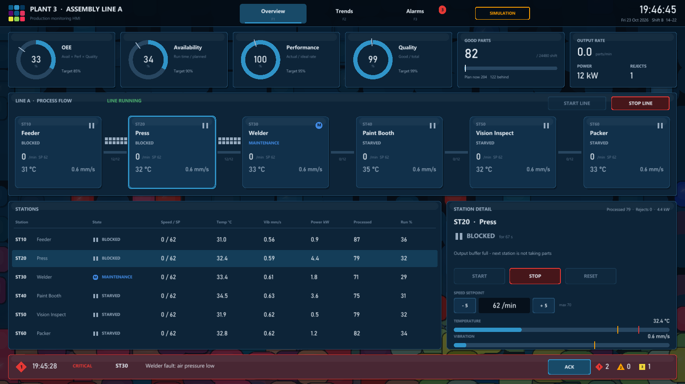

---

## สารบัญ

1. [ภาพรวม](#1-ภาพรวม)
2. [หลักการออกแบบ: นำ Pattern มาใช้กับ HMI อย่างไร](#2-หลักการออกแบบ-นำ-pattern-มาใช้กับ-hmi-อย่างไร)
3. [หน้าจอ](#3-หน้าจอ)
4. [ระบบ Alarm](#4-ระบบ-alarm)
5. [แบบจำลองสายการผลิต](#5-แบบจำลองสายการผลิต)
6. [สถาปัตยกรรมซอฟต์แวร์](#6-สถาปัตยกรรมซอฟต์แวร์)
7. [ติดตั้งและ build](#7-ติดตั้งและ-build)
8. [การใช้งาน](#8-การใช้งาน)
9. [เชื่อมต่อ PLC (Virtual PLC / S7)](#9-เชื่อมต่อ-plc-virtual-plc--s7)
10. [การทดสอบ](#10-การทดสอบ)
11. [ข้อจำกัดและแผนพัฒนาต่อ](#11-ข้อจำกัดและแผนพัฒนาต่อ)

---

## 1. ภาพรวม

FactoryHMI เป็นหน้าจอผู้ควบคุม (operator HMI) ของ **Assembly Line A** ที่มี 6 สถานี ใช้ภาพ mosaic เป็นพื้นหลังและใช้ภาษาภาพเดียวกันกับ MosaicWall (palette, แผงทรง tile มุมมน, ขอบเข้ม, แสงขอบบน) แต่ปรับให้เหมาะกับงานควบคุมจริง

| ความสามารถ | รายละเอียด |
|---|---|
| ภาพรวมการผลิต | OEE, Availability, Performance, Quality, ยอดชิ้นงานเทียบแผน, อัตราผลิต, พลังงาน, ของเสีย |
| Process flow | 6 สถานีพร้อมสถานะ, ความเร็ว, อุณหภูมิ, การสั่น, สายพานพร้อมคิวชิ้นงาน (buffer) |
| ควบคุม | Start/Stop ทั้งสาย, Start/Stop/Reset รายสถานี, ตั้งความเร็ว (มีหน้าต่างยืนยันก่อนสั่ง Start/Stop) |
| Trends | 4 กราฟ real-time ย้อนหลัง 120 วินาที พร้อมเส้น limit และอ่านค่าด้วยเมาส์ |
| Alarms | ตามแนว ISA-18.2: 3 ระดับความสำคัญ, Acknowledge, On-delay, ประวัติ, Event log, Export |
| ปรับขนาดได้ | ออกแบบที่ 1600×900 แล้วย่อ/ขยายตามหน้าต่าง (ทดสอบแล้ว 1280×720 และ 1600×900) |

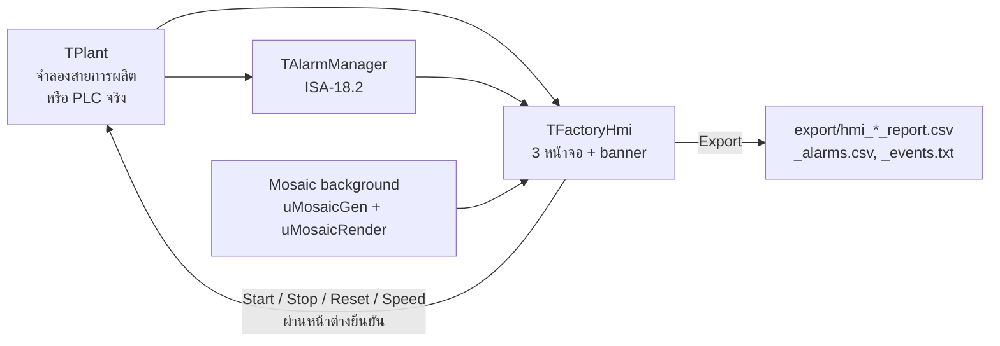

---

## 2. หลักการออกแบบ: นำ Pattern มาใช้กับ HMI อย่างไร

ภาพ mosaic ต้นฉบับมีสีสดจำนวนมาก (แดง ชมพู เหลือง เขียว) ซึ่ง**ชนกับสีที่ HMI สงวนไว้สำหรับ alarm** ถ้าใช้ภาพตรงๆ ผู้ควบคุมจะแยกไม่ออกว่าสีแดงบนจอเป็นลวดลายหรือเครื่องจักรเสีย จึงออกแบบตามแนว **ISA-101 (High Performance HMI)** ดังนี้

| ปัญหา | วิธีแก้ |
|---|---|
| พื้นหลังสีสดแย่งความสนใจ | ทับ mosaic ด้วยม่านสีน้ำเงินเข้ม `#06101B` α165 ใช้ Motion 35 % (ช้า) และ vignette 0.25 ปิดได้ด้วยปุ่ม `B` |
| สีแดง/เหลืองของ mosaic ปนกับ alarm | สี alarm (แดง/อำพัน/เหลือง) ใช้**เฉพาะ alarm** เท่านั้น และทุก alarm มี**รูปทรง + ตัวเลข + ข้อความ** เสมอ |
| สภาวะปกติต้องไม่ดึงสายตา | สถานะปกติใช้โทนน้ำเงิน-เทา ค่าตัวเลขเป็นสีขาว/เทา มีสีเฉพาะเมื่อผิดปกติ |
| ภาษาภาพของ Pattern | แผงเป็นทรง tile มุมมน มีเงา ขอบ และแสงขอบบนแบบเดียวกับ tile ใน mosaic · โลโก้เป็น tile 3×3 สีจาก palette · สี accent = SKY `#3094C8` |

### 2.1 สีและความหมาย

| บทบาท | สี | ที่มา | ใช้กับ |
|---|---|---|---|
| พื้น / แผง | `#06101B` / `#0A1F32` / `#10304B` | ตระกูล BASE ของ mosaic | พื้นหลัง, แผง, แผงเน้น |
| ขอบแผง | `#224C6C` | TEAL_BLUE เข้ม | ขอบทุกแผง |
| Accent | `#3094C8` | SKY | ปุ่มที่เลือก, กราฟปกติ, ring gauge, สายพาน |
| ข้อความ | `#E6EEF5` / `#A0B4C8` / `#688098` | – | หลัก / รอง / จาง |
| Running | `#4CAF6E` ▶ | – | ไอคอนสถานะเท่านั้น |
| Stopped | `#7888A0` ■ | – | |
| Starved / Blocked | `#96AABE` ❚❚ | – | ไม่ใช่ alarm จึงใช้สีกลาง |
| Maintenance | `#428CE6` Ⓜ | – | |
| **Critical (1)** | `#E53935` ◆ | สงวน | Fault |
| **High (2)** | `#FFA000` ▲ | สงวน | อุณหภูมิสูง |
| **Medium (3)** | `#F0D63C` ■ | สงวน | การสั่นสูง, อัตราผลิตต่ำ |

ภาพเดียวกันแบบไม่มี mosaic (กด `B`):

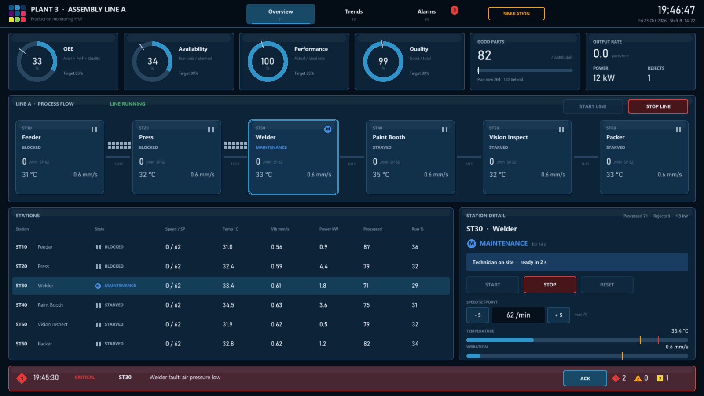

---

## 3. หน้าจอ

### 3.1 โครงหน้าจอ (ทุกหน้า)

| ส่วน | ตำแหน่ง (design 1600×900) | เนื้อหา |
|---|---|---|
| Top bar | y 0–62 | โลโก้ tile, ชื่อโรงงาน/สาย, แท็บ Overview / Trends / Alarms (มีตัวนับ alarm และกะพริบเมื่อมี alarm ที่ยังไม่ ack), ป้าย **SIMULATION**, นาฬิกา, วันที่, กะ (A 06–14, B 14–22, C 22–06) |
| เนื้อหา | y 76–818 | ตามหน้าจอ |
| Alarm banner | y 832–888 | alarm ที่สำคัญที่สุดที่ยังไม่ ack (หรือที่ยัง active) + ปุ่ม ACK + จำนวนแยกตามระดับ · คลิกที่ banner เพื่อไปหน้า Alarms |

### 3.2 Overview (F1)


| ส่วน | รายละเอียด |
|---|---|
| KPI 4 ring | OEE / Availability / Performance / Quality พร้อมขีดเป้าหมาย (85 / 90 / 95 / 99 %) |
| Good parts | ยอดดี / เป้ากะ (24,480), แถบความคืบหน้า, ขีด "แผน ณ ตอนนี้", ล่วงหน้า/ล่าช้ากี่ชิ้น |
| Output rate | ชิ้น/นาที (เฉลี่ย 60 วินาทีล่าสุด), กำลังไฟรวม kW, จำนวนของเสีย |
| Process flow | 6 tile สถานี: รหัส, ชื่อ, ไอคอน+ข้อความสถานะ, ความเร็วจริง/SP, อุณหภูมิ (มี ▲ ถ้าเกิน), การสั่น · สายพานระหว่างสถานีมีลูกศรเคลื่อนที่เมื่อสถานีต้นทางทำงาน และแสดงคิวชิ้นงาน `n/12` · tile ที่ fault มีขอบแดงกะพริบจน ack |
| Stations | ตาราง: สถานะ, Speed/SP, Temp, Vib, Power, Processed, Run % · ค่าเกิน limit มีไอคอนตามระดับ |
| Station detail | สถานะและระยะเวลา, ข้อความ fault / ช่างกำลังซ่อม / เหตุที่ starved/blocked, ปุ่ม START / STOP / RESET, ตั้งความเร็ว ±5, แถบอุณหภูมิ (ขีด HI และ TRIP), แถบการสั่น |

### 3.3 Trends (F2)

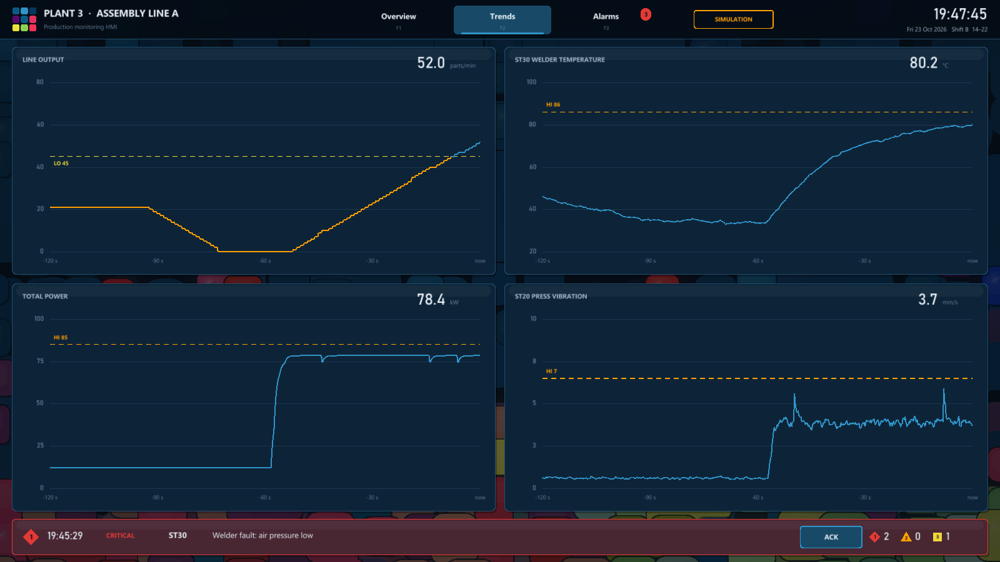

| กราฟ | ช่วง | Limit |
|---|---|---|
| Line output (parts/min) | 0–80 | LO 45 |
| ST30 Welder temperature (°C) | 20–100 | HI 86 |
| Total power (kW) | 0–100 | HI 85 |
| ST20 Press vibration (mm/s) | 0–10 | HI 6.5 |

- เก็บ 5 ค่า/วินาที ย้อนหลัง 120 วินาที (600 จุด)
- เส้นเปลี่ยนเป็นสีอำพันช่วงที่เกิน limit
- เลื่อนเมาส์บนกราฟเพื่ออ่านค่าและเวลาย้อนหลัง

### 3.4 Alarms (F3)

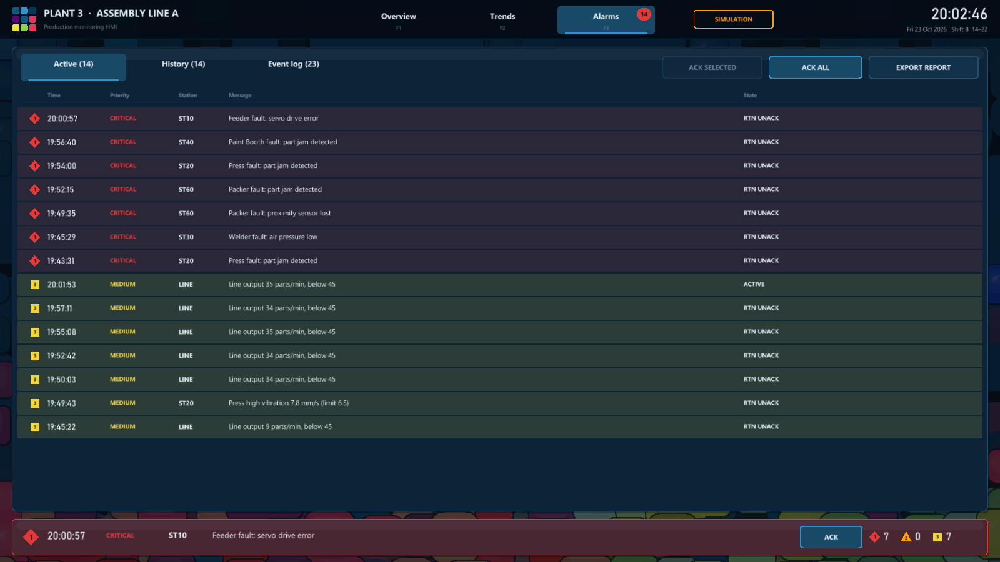

| ส่วน | รายละเอียด |
|---|---|
| Active | alarm ที่ยังไม่ปิด เรียง: ยังไม่ ack ก่อน → ระดับ → ใหม่สุด · แถวที่ยังไม่ ack มีพื้นสีตามระดับ และไอคอนกะพริบถ้ายัง active |
| History | ทุก alarm ใหม่สุดก่อน พร้อมสถานะปัจจุบัน |
| Event log | การกระทำของผู้ควบคุมและเหตุการณ์ (start/stop/reset/setpoint/ซ่อม/export) |
| ปุ่ม | ACK SELECTED, ACK ALL, EXPORT REPORT · เลื่อนรายการด้วย mouse wheel |

### 3.5 หน้าต่างยืนยันคำสั่ง

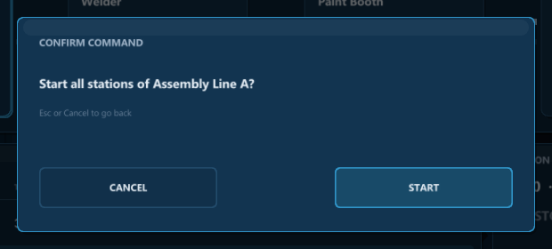

คำสั่งที่ทำให้เครื่องจักรเริ่มหรือหยุด (START/STOP LINE, START/STOP สถานี) ต้องยืนยันก่อนทุกครั้ง ปุ่มยืนยันเป็นสีแดงสำหรับ STOP และสีฟ้าสำหรับ START · `Esc` หรือ CANCEL เพื่อยกเลิก · ขณะเปิดหน้าต่างนี้ ปุ่มอื่นทั้งหมดถูกปิดการกด

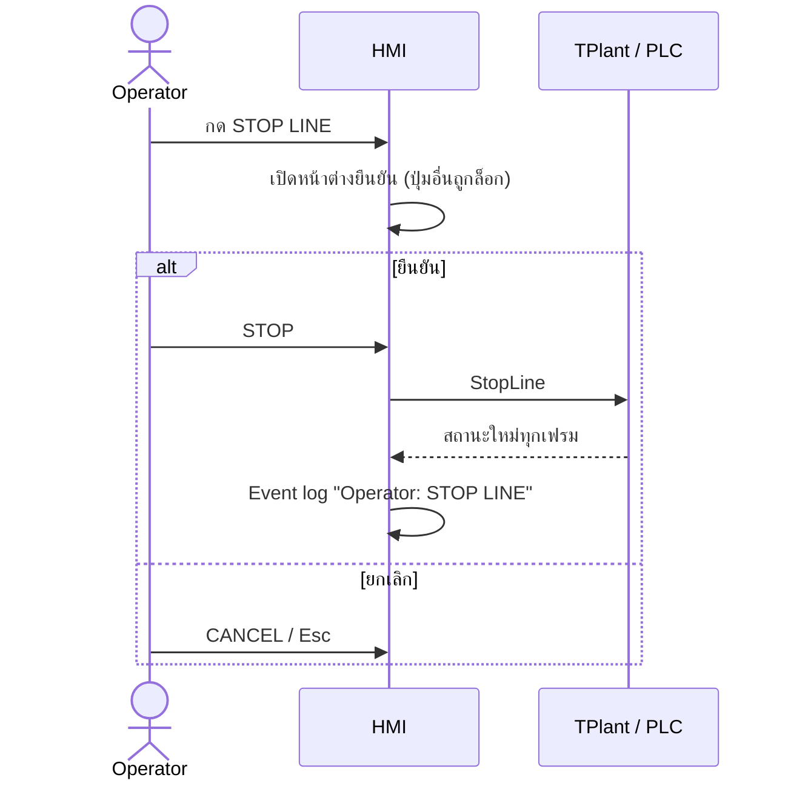

---

## 4. ระบบ Alarm

### 4.1 สถานะ (ตามแนว ISA-18.2)

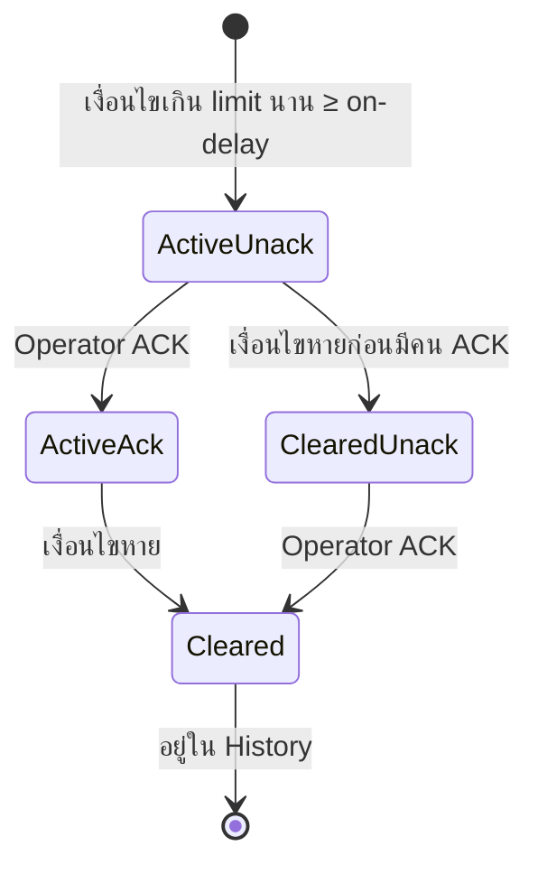

| สถานะ | แสดงเป็น | อยู่ในรายการ Active |
|---|---|---|
| ACTIVE (ยังไม่ ack) | ไอคอนกะพริบ, พื้นสีตามระดับ, banner สีตามระดับ | ✔ |
| ACKED | ปกติ | ✔ |
| RTN UNACK (หายแล้วแต่ยังไม่มีคนเห็น) | พื้นสีตามระดับ ไม่กะพริบ | ✔ |
| CLEARED | สีจาง | – (อยู่ใน History) |

### 4.2 รายการ alarm

| Tag | ระดับ | เงื่อนไข | On-delay | คืนสภาพ |
|---|---|---|---|---|
| `STxx.FAULT` | 1 Critical ◆ | สถานี fault (สุ่ม หรือ over-temperature trip) | – | Reset หรือซ่อมเสร็จ |
| `STxx.TEMP_HI` | 2 High ▲ | อุณหภูมิ > HI | 3 s | < HI − 3 °C |
| `STxx.VIB_HI` | 3 Medium ■ | การสั่น > HI | 3 s | < HI − 0.8 mm/s |
| `LINE.RATE_LO` | 3 Medium ■ | อัตราผลิต < 45 ชิ้น/นาที (หลังสายเดินแล้ว 60 s) | 10 s | > 48 ชิ้น/นาที |

**On-delay** ช่วยกันไม่ให้ค่าที่กระโดดชั่วครู่ (เช่น แรงกระแทกสั้นๆ) สร้าง alarm ซ้ำๆ ก่อนใส่ on-delay ทดลองจำลอง 3 นาทีได้ 12 alarm ของการสั่นจากแรงกระแทกสั้นๆ หลังใส่เหลือ 0 และ alarm ทั้งหมดมีสาเหตุจริง (fault, bearing สึกของ Press, อัตราผลิตต่ำ)

---

## 5. แบบจำลองสายการผลิต

### 5.1 สถานี

| รหัส | ชื่อ | Speed max (ชิ้น/นาที) | Temp HI / TRIP (°C) | Vib HI (mm/s) | กำลังไฟพิกัด (kW) |
|---|---|---|---|---|---|
| ST10 | Feeder | 80 | 70 / 80 | 7.0 | 4.5 |
| ST20 | Press | 70 | 78 / 88 | 6.5 | 22 |
| ST30 | Welder | 70 | 86 / 95 | 7.0 | 35 |
| ST40 | Paint Booth | 75 | 60 / 68 | 5.0 | 18 |
| ST50 | Vision Inspect | 90 | 55 / 62 | 4.0 | 2.5 |
| ST60 | Packer | 80 | 65 / 75 | 6.0 | 6 |

ค่าเริ่มต้น: speed setpoint 62 ชิ้น/นาที, buffer ระหว่างสถานี 12 ชิ้น (เริ่มที่ 4)

### 5.2 สถานะของสถานี

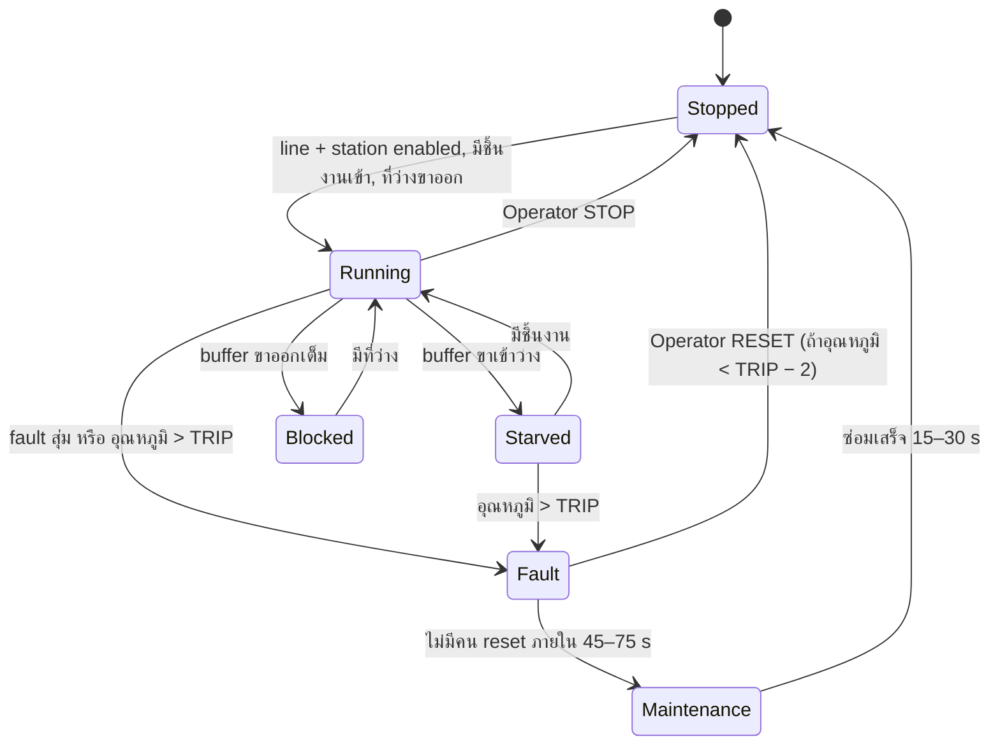

### 5.3 กลไกจำลอง

| เรื่อง | สูตร / ค่า |
|---|---|
| ความเร็ว | เข้าหา setpoint แบบ first-order (×1.5/s) เมื่อ Running, ลดลงเมื่อหยุด |
| การไหลของชิ้นงาน | สถานี Running ทำชิ้นงานด้วยอัตรา speed/60 ต่อวินาที เอาจาก buffer ขาเข้า ส่งไป buffer ขาออก · ชิ้นงานที่ออกจาก ST60 = good |
| อุณหภูมิ | `T → 32 + rise × load × (0.9 + 0.25 × SP/max)` เวลาคงที่ 20 s + noise |
| การสั่น | `0.6 + 4.2 × load² (+ bearing wear)` + noise · Press มีโอกาส bearing สึก (+3.2–4.7 mm/s นาน 40–80 s) |
| กำลังไฟ | Running 25–100 % ของพิกัดตาม load · Starved/Blocked 20 % · หยุด 5 % |
| ของเสีย | ที่ ST50: 1.5 % + 1 % ต่อทุก 1 °C ที่ Welder เกิน 80 °C |
| Fault | 1/900 ต่อสถานี-วินาทีขณะ Running (โหมด demo ≈ 1 ครั้งต่อ 2.5 นาทีทั้งสาย) สาเหตุ: motor overload, part jam, proximity sensor lost, safety door opened, servo drive error, air pressure low |
| สุ่ม | xorshift64 แยกของตัวเอง (ไม่ยุ่งกับ `Random` ที่ใช้สร้าง mosaic) |

### 5.4 KPI

| KPI | สูตร |
|---|---|
| Availability | เวลาที่ ST60 Running / เวลาที่ผ่านไปของกะ |
| Performance | (ดี + เสีย) / (เวลา run เป็นนาที × 60 ชิ้น/นาที) |
| Quality | ดี / (ดี + เสีย) |
| OEE | Availability × Performance × Quality |
| เป้ากะ | 8 ชม. × 60 ชิ้น/นาที × 85 % = 24,480 ชิ้น |

---

## 6. สถาปัตยกรรมซอฟต์แวร์

| ไฟล์ | หน้าที่ |
|---|---|
| `FactoryHMI.lpr` | โปรแกรมหลัก: หน้าต่าง, loop, CLI, โหมดถ่ายภาพ headless |
| `uFactoryHmi.pas` | `TFactoryHmi`: วาดทุกหน้าจอ, banner, หน้าต่างยืนยัน, export, พื้นหลัง mosaic |
| `uHmiTheme.pas` | สี, ฟอนต์ (Segoe UI / Segoe UI Bold / Bahnschrift สำหรับตัวเลข), ฟังก์ชันข้อความ, แผงทรง tile, ไอคอนสถานะและ alarm |
| `uHmiWidgets.pas` | ปุ่มและแท็บแบบ immediate-mode (ทำงานตอนปล่อยนิ้ว, ล็อกเมื่อมีหน้าต่าง modal) |
| `uPlantSim.pas` | `TPlant`: สถานี, buffer, สถานะ, ค่ากระบวนการ, KPI, trends, คำสั่ง, รายงาน CSV · โหมด `Live` เมื่อข้อมูลมาจาก PLC |
| `uPlcDriver.pas` | `TPlcDriver`: thread อ่าน DB10 ของ PLC ทุก 200 ms, คิวคำสั่ง, `Apply` คัดลอกค่าเข้า `TPlant` ใต้ lock (ข้อ 9) |
| `uPlcClient.pas` | S7 client (ISO-on-TCP) แบบ Pascal ล้วน คัดลอกจากโปรเจกต์ Virtual PLC ไม่ต้องใช้ DLL |
| `plc\FactoryLine.scl` | โปรแกรม PLC ของสายการผลิต (DB10, FB1, FB2, OB1) สำหรับ Virtual PLC |
| `uAlarms.pas` | `TAlarmManager`: alarm ตาม ISA-18.2, ack, นับ, CSV |
| `uMosaicGen/Render/Palette/Noise/Types` | ใช้ร่วมกับ MosaicWall (พื้นหลัง) |

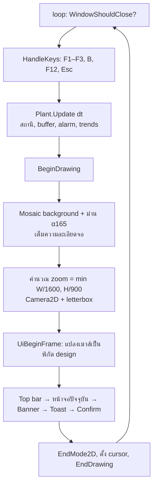

**การย่อ/ขยาย:**
- ทุกอย่างวาดที่พิกัด 1600×900 ภายใน `Camera2D` แล้วย่อหรือขยายตามขนาดหน้าต่าง
- ฟอนต์โหลดที่ 64 px พร้อม mipmap และ trilinear filter ตัวหนังสือจึงคมทั้งตอนย่อและขยาย
- พื้นหลัง mosaic วาดที่ความละเอียดจริงของจอ จึงเต็มจอเสมอ รวมถึงขอบ letterbox

---

## 7. ติดตั้งและ build

ความต้องการเหมือน MosaicWall (ดู `SPEC_MosaicWallpaper.md` ข้อ 7): Windows 10/11 x64, Lazarus 3.x, `raylib.dll` 5.5 x64, OpenGL 3.3 ฟอนต์ใช้ของ Windows (`segoeui.ttf`, `segoeuib.ttf`, `bahnschrift.ttf`) ถ้าไม่มีจะใช้ Arial หรือฟอนต์ของ raylib แทน

```bash
C:/lazarus/lazbuild.exe FactoryHMI.lpi
```

หรือเปิด `FactoryHMI.lpi` ใน Lazarus แล้ว Run (F9)

Deploy: คัดลอก `FactoryHMI.exe` + `raylib.dll` ไว้โฟลเดอร์เดียวกัน

---

## 8. การใช้งาน

### 8.1 ปุ่มลัด

| ปุ่ม | การทำงาน |
|---|---|
| `F1` / `1` | Overview |
| `F2` / `2` | Trends |
| `F3` / `3` | Alarms |
| `B` | เปิด/ปิดพื้นหลัง mosaic |
| `F` | Fullscreen |
| `F12` | Screenshot (`hmi_screen_<เวลา>.png` ข้างโปรแกรม) |
| `Esc` | ปิดหน้าต่างยืนยันเท่านั้น (**ไม่ปิดโปรแกรม** เพื่อกันกดพลาด ปิดโปรแกรมด้วยปุ่ม X) |

### 8.2 Command line

| ตัวเลือก | ความหมาย | ค่าเริ่มต้น |
|---|---|---|
| `--size WxH` | ขนาดหน้าต่าง | 1600x900 |
| `--start` | เริ่มสายการผลิตทันที | สายหยุด รอผู้ควบคุมกด START LINE |
| `--nomosaic` | พื้นหลังเรียบ | – |
| `--shot FILE.png` | headless: จำลองแล้วบันทึกภาพ 1 หน้าจอ แล้วออก | – |
| `--screen N` | หน้าจอของ `--shot` 1/2/3 | 1 |
| `--sim S` | วินาทีที่จำลองก่อนถ่าย | 180 |
| `--select N` | สถานีที่แสดงในแผง detail 1–6 | 3 |
| `--plc [HOST]` | ข้อมูลจริงจาก PLC Siemens S7 (TCP 102) แทนการจำลอง | ไม่ใช้ (จำลอง) · HOST = `127.0.0.1` |
| `--plc-db N` | เลขที่ DB ของ HMI ใน PLC | 10 |
| `--plc-slot N` | slot ของ CPU | auto (ลอง 1, 2, 3, 0) |

เมื่อใช้ `--plc` กับ `--shot`: รอตามเวลาจริง `--sim` วินาที และ `--start` จะส่งคำสั่ง START LINE ไปที่ PLC (ใช้ทดสอบ headless)

### 8.3 ขั้นตอนการทำงานของผู้ควบคุม

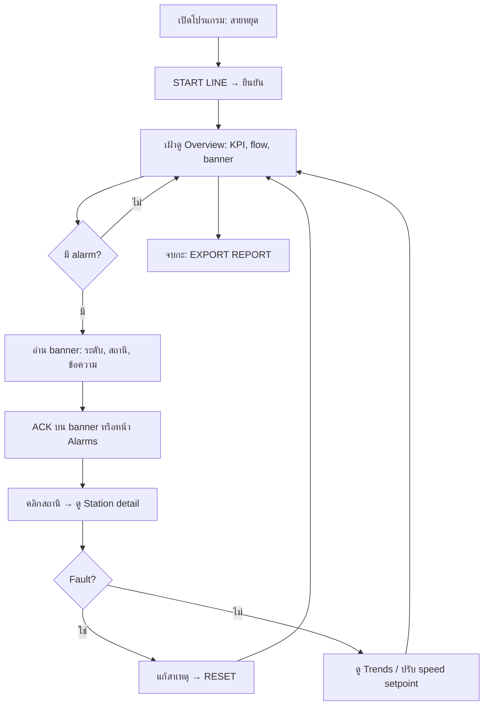

### 8.4 Export

ปุ่ม **EXPORT REPORT** (หน้า Alarms) สร้างไฟล์ใน `export\`:

| ไฟล์ | เนื้อหา |
|---|---|
| `hmi_<เวลา>_report.csv` | กะ, KPI (OEE/A/P/Q, ดี, เสีย, อัตรา, kW) และค่าทุกสถานี |
| `hmi_<เวลา>_alarms.csv` | `id, raised, priority, station, tag, text, state, acked, cleared` |
| `hmi_<เวลา>_events.txt` | Event log |

---

## 9. เชื่อมต่อ PLC (Virtual PLC / S7)

`TPlant` ทำหน้าที่เป็น **data model** ของ HMI หน้าจอไม่รู้ว่าข้อมูลมาจากการจำลองหรือ PLC จึงเปลี่ยนแหล่งข้อมูลได้โดยไม่ต้องแก้หน้าจอ ค่าเริ่มต้นยังเป็นการจำลอง (`uPlantSim.pas`) ใส่ `--plc` เพื่อใช้ข้อมูลจริง

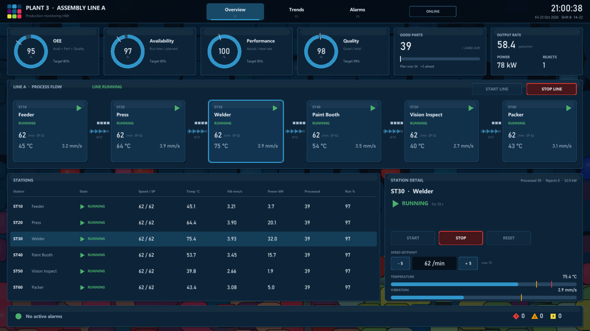

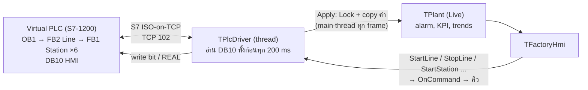

### 9.1 การตั้งค่า Virtual PLC

| ขั้น | ที่ไหน | ทำอะไร |
|---|---|---|
| 1 | `UI04\Virtual PLC Papercut SDL3\VirtualPLC.exe` | เปิดโปรแกรม (CPU 1214C, S7-1200) |
| 2 | Program → SCL source → **Import .scl source ...** | นำเข้า `plc\FactoryLine.scl` (DB10 "HMI", FB1 "Station", FB2 "Line", "Line_DB", OB1) |
| 3 | Data blocks → DB10 "HMI" | ตรวจว่า **Optimized DB: OFF** (S7-1200 สร้าง DB ใหม่แบบ optimized ซึ่งไม่ให้อ่านแบบ absolute) |
| 4 | Ports → S7 communication | เปิด **S7 server** (TCP 102) และติ๊ก **Permit access with PUT/GET** (ไม่ติ๊ก = PLC ตอบ error class 0x81 code 0x04) |
| 5 | แถบบน | **Download** (F8) แล้ว **RUN** · บันทึกโปรเจกต์ (Ctrl+S) เพื่อเก็บค่า Ports |
| 6 | (ถ้าให้ Claude Code แก้โปรแกรม) Ports | เปิด **IPC server** และ **Claude Code may change the program** |

จากนั้น:

```bash
FactoryHMI.exe --plc
```

ป้ายบนแถบบนเปลี่ยนจาก SIMULATION เป็น **ONLINE** (กรอบเทา) หรือ **OFFLINE** (สีแดงกระพริบ เพราะเป็นสภาวะ alarm) · PLC บนเครื่องอื่น: `--plc 192.168.0.10` และใน Ports ของ PLC ให้ listen บนทุก interface (0.0.0.0)

ส่งออกโปรแกรม PLC จาก Virtual PLC ที่เปิดอยู่เป็น `.scl` อีกครั้ง (ผ่าน IPC pipe, ต้องเปิด IPC server): `python plc\export_scl.py plc\FactoryLine.scl`

### 9.2 DB10 "HMI" (non-optimized, 220 byte)

แต่ละสถานีใช้ 36 byte เริ่มที่ `i × 36` (ST10 = 0, ST20 = 36 … ST60 = 180) ชื่อตัวแปรใน PLC คือ `STxx_<ชื่อ>` (ไม่มี PLC data type เพราะ tool ของ Virtual PLC สร้าง UDT ไม่ได้ แต่ layout เท่ากับ struct)

| Offset | Tag | ชนิด | ทิศทาง | ความหมาย |
|---|---|---|---|---|
| +0 | `STxx_State` | INT | อ่าน | 0 stop, 1 run, 2 starved, 3 blocked, 4 fault, 5 maint |
| +2 | `STxx_FaultCode` | INT | อ่าน | 1 motor overload, 2 part jam, 3 proximity sensor lost, 4 safety door, 5 servo drive, 6 air pressure, 7 over-temperature |
| +4 | `STxx_Speed` | REAL | อ่าน | ชิ้น/นาที |
| +8 | `STxx_SpeedSP` | REAL | อ่าน / **เขียน** | PLC จำกัดค่า 10 … SpeedMax |
| +12 / +16 / +20 | `STxx_Temp`, `STxx_Vib`, `STxx_Power` | REAL | อ่าน | °C, mm/s, kW |
| +24 / +28 | `STxx_Count`, `STxx_Reject` | DINT | อ่าน | ชิ้นที่ทำแล้ว / ของเสีย (ของเสียเกิดที่ ST50) |
| +32 | `STxx_InBuf` | INT | อ่าน | ชิ้นงานที่รออยู่หน้าสถานี (เพิ่มจากตารางเดิม เพื่อแสดง buffer) |
| +34.0 / .1 / .2 | `STxx_CmdStart`, `CmdStop`, `CmdReset` | BOOL | **เขียน** (pulse) | HMI ตั้งเป็น TRUE, PLC ล้างเป็น FALSE เมื่อจัดการแล้ว |
| +34.3 | `STxx_Enabled` | BOOL | อ่าน | latch การ start ของสถานี (ใช้เปิด/ปิดปุ่ม START / STOP) |
| 216 | `LINE_Heartbeat` | INT | อ่าน | PLC นับทุก cycle · HMI ไม่ส่งคำสั่งถ้าค่านี้หยุดนิ่งเกิน 1.5 s (CPU STOP) |
| 218.0 | `LINE_Running` | BOOL | อ่าน | latch ของสาย |
| 218.1 / 218.2 | `LINE_CmdStart`, `LINE_CmdStop` | BOOL | **เขียน** (pulse) | |

ชิ้นงานดี = `ST60_Count`, ของเสียรวม = ผลรวมของ `STxx_Reject`

### 9.3 Driver (`uPlcDriver.pas`)

| เรื่อง | การทำงาน |
|---|---|
| Thread | `TPlcDriver` (TThread) อ่าน DB10 ทั้ง 220 byte ด้วย Read Var ครั้งเดียวทุก 200 ms (`PeriodMs`) เก็บใน snapshot ใต้ `TCriticalSection` |
| เข้า `TPlant` | `TFactoryHmi.Update` เรียก `Driver.Apply(Plant)` ทุก frame: คัดลอก snapshot ใต้ lock เดียวกัน · เฉพาะ main thread แตะ `TPlant` และหน้าจอ |
| คำสั่ง | `StartLine` / `StopLine` / `StartStation` / `StopStation` / `ResetStation` / `SetSpeed` ของ `TPlant` ในโหมด `Live` ไม่เปลี่ยนค่าเอง แต่เรียก `OnCommand` → `Driver.Post` (คิว) แล้ว thread เขียน bit / REAL ไปที่ PLC ทันที (ปลุกด้วย `TEvent`) |
| ต่อใหม่ | อ่านไม่ได้ → ปิด socket แล้วลองต่อใหม่ทุก 1 s · slot ลอง 1, 2, 3, 0 อัตโนมัติ |
| Communication lost | อ่านไม่ได้ติดกัน 3 ครั้ง (`COMM_FAIL_LIMIT`) → alarm **Critical** `PLC.COMM` "Communication lost: PLC … not answering" และป้าย OFFLINE · ระหว่างนั้นไม่ประเมิน alarm อื่นจากค่าเก่า · อ่านได้อีกครั้ง → alarm กลับเป็นปกติ (RTN) |
| Event log | ต่อได้, อ่านไม่ได้ (พร้อมสาเหตุ), คำสั่งที่ส่งหรือไม่ได้ส่ง บันทึกใน Event log ของหน้า Alarms |
| HMI ยังคำนวณเอง | alarm TEMP_HI / VIB_HI (on-delay 3 s), alarm FAULT จาก State, output rate จาก `ST60_Count`, run time, KPI, trends |

### 9.4 Interlock อยู่ใน PLC

HMI ส่งแค่ **คำขอ** PLC เป็นผู้ตัดสิน (FB1 "Station" network 1):

- START (ทั้งสายหรือสถานี) ไม่มีผลขณะสถานี fault หรือซ่อม
- RESET ได้เฉพาะเมื่อ fault และอุณหภูมิต่ำกว่า trip − 2 °C
- SpeedSP ถูกจำกัดที่ 10 … SpeedMax ใน PLC
- over-temperature trip, fault, maintenance (fault ที่ไม่มีคน reset 60 s → ซ่อม 20 s) คำนวณใน PLC

ห้ามใช้ HMI เป็นตัวป้องกันความปลอดภัย

### 9.5 โปรแกรม PLC (`plc\FactoryLine.scl`)

| Block | หน้าที่ |
|---|---|
| OB1 "Main" | เรียก `"Line_DB"()` |
| FB2 "Line" | heartbeat, time base 100 ms (TON), latch ของสาย, เรียก 6 สถานี (multi-instance), ย้ายชิ้นงานระหว่าง buffer (เต็มที่ 12), ของเสียที่ ST50 (ชิ้นที่ 50 ทุกรอบ และ 1 ใน 10 เมื่อ Welder > 80 °C) |
| FB1 "Station" | คำขอ + interlock, state machine, speed ramp, อุณหภูมิ (lag 20 s), การสั่น, กำลังไฟ, trip, fault สุ่ม (~1 ครั้ง / 30 นาที / สถานีที่ run) ตามค่าในข้อ 5.1 |

---

## 10. การทดสอบ

| การทดสอบ | ผล |
|---|---|
| Build ด้วย lazbuild (FPC 3.2.2 Win64) | ✅ ไม่มี error/warning |
| Render ทั้ง 3 หน้าจอแบบ headless (1600×900 และ 1280×720) | ✅ |
| คลิกจริงด้วยเมาส์: START LINE → หน้าต่างยืนยัน → START → สายเดิน → เลือกสถานี ST40 | ✅ |
| ปิดด้วยปุ่ม X ของหน้าต่าง | ✅ exit code 0 |
| Alarm: เวลาตามนาฬิกาของโรงงาน, on-delay กัน alarm ซ้ำ, การเรียงลำดับ, RTN UNACK | ✅ (จำลอง 3 / 10 / 20 นาที) |
| Cascade: สถานีที่ fault/ซ่อม ทำให้สถานีก่อนหน้า BLOCKED (buffer 12/12) และสถานีถัดไป STARVED | ✅ เห็นในภาพ Overview |
| `--plc` กับ Virtual PLC (S7-1200, 127.0.0.1:102): อ่าน DB10, ป้าย ONLINE, ค่าจริงบนทุกหน้าจอ | ✅ offset ทุกตัวตรงกับ `"HMI".Var` (เช่น DBW216 = heartbeat, DBD188 = 62.0) |
| START LINE จาก HMI (`--plc --start --shot`) → `LINE_Running` = TRUE, ทั้ง 6 สถานี RUNNING 62/min, PLC ล้าง `LINE_CmdStart` | ✅ |
| SetSpeed ST30 55 → `ST30_SpeedSP` = 55, STOP / START ST40, STOP LINE | ✅ (โปรแกรมทดสอบ driver) |
| ไม่มี PLC: ป้าย OFFLINE + alarm Critical "Communication lost" หลังอ่านไม่ได้ 3 ครั้ง | ✅ |
| PUT/GET ปิด: PLC ตอบ error class 0x81 code 0x04, HMI แสดง OFFLINE และบันทึกสาเหตุ | ✅ |

ยังไม่ได้ทดสอบ: จอสัมผัส, จอ 4K, ใช้งานต่อเนื่องหลายชั่วโมง, PLC ฮาร์ดแวร์จริง, การนำเข้า `plc\FactoryLine.scl` ลง Virtual PLC เครื่องใหม่ (ไฟล์ส่งออกจากโปรแกรมที่รันอยู่ แต่ยังไม่ได้ลองนำเข้า), interlock RESET / fault ผ่าน HMI

---

## 11. ข้อจำกัดและแผนพัฒนาต่อ

| # | เรื่อง | สถานะ / แนะนำ |
|---|---|---|
| 1 | ข้อความบนจอเป็นภาษาอังกฤษ | raylib วาดตัวอักษรทีละตัวโดยไม่จัดตำแหน่งสระ/วรรณยุกต์ไทย ถ้าต้องการภาษาไทยควรทำ shaping (เช่น HarfBuzz) หรือใช้ LCL สำหรับข้อความ |
| 2 | ไม่มีระบบ login / สิทธิ์ผู้ใช้ | ควรมีระดับ Operator / Engineer / Admin ก่อนใช้งานจริง (เช่น จำกัดการเปลี่ยน setpoint) |
| 3 | ประวัติ alarm/event อยู่ในหน่วยความจำ | ควรบันทึกลงฐานข้อมูลหรือไฟล์ทันทีเพื่อ audit trail |
| 4 | ไม่มีเสียงเตือน | เพิ่มเสียงตามระดับ alarm (raylib มี audio อยู่แล้ว) และปุ่ม Silence |
| 5 | ข้อมูลจำลองเป็นค่าเริ่มต้น | ✅ เชื่อม Virtual PLC ได้แล้ว (`--plc`, ข้อ 9) · ยังไม่มีหน้าตั้งค่าแหล่งข้อมูลในโปรแกรม และยังไม่รองรับ Modbus TCP / OPC UA |
| 6 | Alarm shelving / suppression | ISA-18.2 แนะนำให้มีสำหรับ alarm ที่รู้สาเหตุแล้ว |
| 7 | ความเร็ว fault ในโหมด demo สูงกว่าจริง | ปรับ `FAULT_RATE` ใน `uPlantSim.pas` |
| 8 | Trend ย้อนหลังได้ 120 วินาที | เพิ่ม historian และเลือกช่วงเวลา |
