# MosaicWall — เอกสารออกแบบ วิเคราะห์ และคู่มือพัฒนา

| รายการ | ค่า |
|---|---|
| เวอร์ชันเอกสาร | 2.0 (วิเคราะห์ใหม่ทั้งหมด) — 2026-10-23 |
| ภาพอ้างอิง | `0653bb4e017433b0c1e6c135a6e6d4a9.png` |
| สถานะ | พัฒนาแล้ว: MosaicWall (M1–M7), MosaicWallDev (หน้าต่างนักพัฒนา), ระบบ Motion |
| แพลตฟอร์ม | Windows 10/11 x64 · Lazarus 3.4 / FPC 3.2.2 · raylib 5.5 (DLL) · OpenGL 3.3 |
| ภาพประกอบ / ข้อมูล | `docs/img/` (รูป), `docs/data/` (ผลวิเคราะห์ JSON), `tools/` (สคริปต์ที่รันซ้ำได้) |

> **การดู Flow chart:** แผนภาพในเอกสารนี้เขียนด้วย [Mermaid](https://mermaid.js.org) ซึ่ง GitHub, GitLab, Obsidian และ VS Code (ติดตั้งส่วนขยาย *Markdown Preview Mermaid Support*) แสดงเป็นภาพให้อัตโนมัติ ส่วนภาพประกอบอื่นเป็นไฟล์ SVG/PNG ที่เปิดดูได้ทุกที่

---

## สารบัญ

1. [ภาพรวมโครงการ](#1-ภาพรวมโครงการ)
2. [วิเคราะห์ภาพอ้างอิง (ฉบับละเอียด)](#2-วิเคราะห์ภาพอ้างอิง-ฉบับละเอียด)
3. [การออกแบบ (Design spec)](#3-การออกแบบ-design-spec)
4. [อัลกอริทึม](#4-อัลกอริทึม)
5. [สถาปัตยกรรมซอฟต์แวร์](#5-สถาปัตยกรรมซอฟต์แวร์)
6. [MosaicWallDev — หน้าต่างสถานะสำหรับนักพัฒนา](#6-mosaicwalldev--หน้าต่างสถานะสำหรับนักพัฒนา)
7. [การติดตั้ง](#7-การติดตั้ง)
8. [การใช้งาน](#8-การใช้งาน)
9. [นำไปใช้ในโปรเจกต์อื่น](#9-นำไปใช้ในโปรเจกต์อื่น)
10. [การทดสอบและเกณฑ์ตรวจรับ](#10-การทดสอบและเกณฑ์ตรวจรับ)
11. [ข้อแนะนำและแผนพัฒนาต่อ](#11-ข้อแนะนำและแผนพัฒนาต่อ)
12. [ประวัติการเปลี่ยนแปลง](#12-ประวัติการเปลี่ยนแปลง)
13. [ภาคผนวก](#13-ภาคผนวก)

---

## 1. ภาพรวมโครงการ

### 1.1 เป้าหมาย

สร้างภาพพื้นหลังแบบ **procedural** (สร้างด้วยโค้ด ไม่โหลดไฟล์ภาพ) ที่หน้าตาเหมือนภาพอ้างอิง เป็นกระเบื้องมุมมนที่ไล่สีจากน้ำเงินด้านบนไปเป็นแดง ชมพู เหลือง และเขียวด้านล่าง และ**เคลื่อนไหวได้** ใช้เป็น wallpaper, ฉากหลังของ UI หรือ export เป็นภาพความละเอียดสูง

### 1.2 สิ่งที่ส่งมอบ

| ชิ้นงาน | ไฟล์ | หน้าที่ |
|---|---|---|
| โปรแกรมหลัก | `MosaicWall.lpi` → `MosaicWall.exe` | หน้าต่าง mosaic แบบ animated พร้อมปุ่มคีย์บอร์ด และ CLI สำหรับ export/bench |
| เครื่องมือนักพัฒนา | `MosaicWallDev.lpi` → `MosaicWallDev.exe` | หน้าต่าง mosaic + หน้าต่างสถานะ (LCL) แสดงค่าทั้งหมด ควบคุมได้ และ export ได้ |
| Engine ร่วม | `uMosaic*.pas`, `uPalette.pas`, `uNoise.pas`, `uSysInfo.pas`, `raylib.pas` | โค้ดสร้างภาพ วาดภาพ สถิติ และรายงาน |
| เครื่องมือวิเคราะห์ | `tools/analyze_image.ps1`, `tools/make_figures.py`, `tools/verify.ps1` | วัดภาพ สร้างกราฟ และตรวจรับอัตโนมัติ |
| เอกสาร | ไฟล์นี้ + `docs/` | สเปก ผลวิเคราะห์ คู่มือ |

### 1.3 ภาพรวมการทำงาน

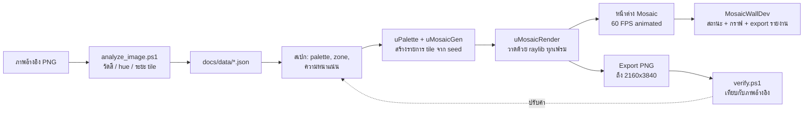

### 1.4 ผลลัพธ์เทียบกับภาพอ้างอิง

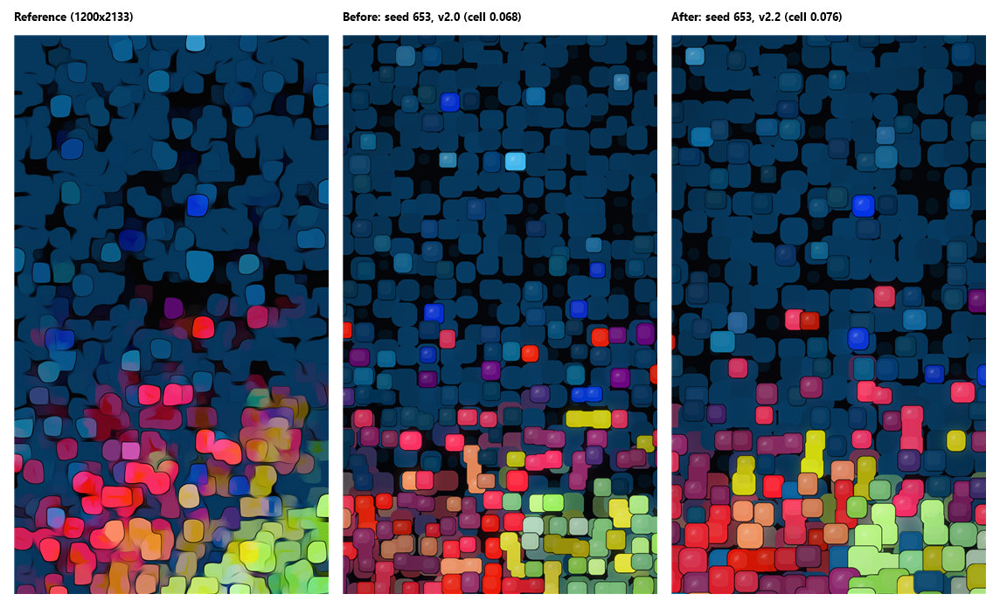

*ซ้าย: ภาพอ้างอิง · กลาง: ก่อนปรับ (v2.0, cell 0.068) · ขวา: v2.2 (R1 + R2 + R3, cell 0.076) ทั้งสองภาพ seed 653 (ดูข้อ 11)*

---

## 2. วิเคราะห์ภาพอ้างอิง (ฉบับละเอียด)

### 2.1 วิธีวิเคราะห์

การวิเคราะห์รอบนี้วัดจากพิกเซลจริง (ไม่ได้ประมาณด้วยตา) และรันซ้ำได้ ผลอยู่ใน `docs/data/reference_analysis.json` ส่วนภาพที่โปรแกรมสร้าง (seed 653) วัดด้วยวิธีเดียวกันไว้ใน `docs/data/render_analysis.json`

```bash
powershell -ExecutionPolicy Bypass -File tools/analyze_image.ps1 0653bb4e017433b0c1e6c135a6e6d4a9.png docs/data/reference_analysis.json
```

```bash
python tools/make_figures.py
```

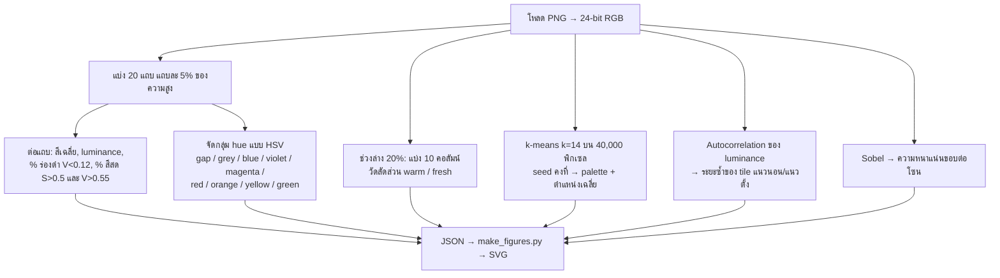

### 2.2 ข้อมูลไฟล์

| รายการ | ค่า |
|---|---|
| ขนาด | 1200 × 2133 px (แนวตั้ง 9:16) |
| ขนาดไฟล์ | ≈ 3.0 MB (PNG) |
| ประเภทภาพ | Abstract mosaic / wallpaper มือถือ ผ่านฟิลเตอร์แนว "oil paint / cutout" (ขอบมีเส้นเข้ม ภายในก้อนมีคราบแสง) |
| สีที่ครองพื้นที่มากที่สุด | `#08375D` น้ำเงินหม่น **47.7 %** ของพิกเซล |

### 2.3 องค์ประกอบที่มองเห็น

| องค์ประกอบ | ลักษณะ | สิ่งที่วัดได้ |
|---|---|---|
| **พื้นหลัง** | น้ำเงินเข้มอมเทา ปกคลุมเกือบทั้งภาพ | `#08375D` 47.7 % + น้ำเงินมืด `#0E1E36` 7.4 % |
| **ร่องดำ** | แฉกรูปดาวระหว่างก้อน ให้ความลึก | 13.3 % ของภาพ หนาแน่นที่ 40–50 % ของความสูง (สูงสุด 33 % ที่แถบ 40 %) แทบหายไปช่วงล่าง (1.5–3 %) |
| **Tile** | สี่เหลี่ยมมุมมนมาก ขนาดไม่เท่ากัน รูปทรงบิดเบี้ยวเล็กน้อย หลายก้อนหลอมเป็นกลุ่ม | ระยะซ้ำ (pitch) แนวตั้ง 126 px = **5.9 % ของความสูง** แนวนอน 162 px = 13.5 % ของความกว้าง (เป็นระยะของกลุ่ม 2 ก้อน ซึ่งกว้างกว่า tile เดี่ยว) |
| **เส้นขอบ / แสง** | ขอบเข้มรอบก้อนสีสด มีริ้วแสงเฉียงในก้อน | ความหนาแน่นขอบ (Sobel) Z0 4.8 % → Z3 13.1 % (ยิ่งลงล่างยิ่งมีรายละเอียด) |
| **การไล่สี** | บนเย็น → ล่างร้อน และช่วงล่างแบ่งซ้ายแดง/ขวาเขียว | ดูข้อ 2.4–2.6 |
| **ความเบลอ** | สีลามข้ามขอบก้อน (bleed) โดยเฉพาะช่วงล่าง | สังเกตด้วยตา (ภาพข้อ 1.4) ยังไม่มีตัวชี้วัด |

### 2.4 สีเฉลี่ยตามความสูง

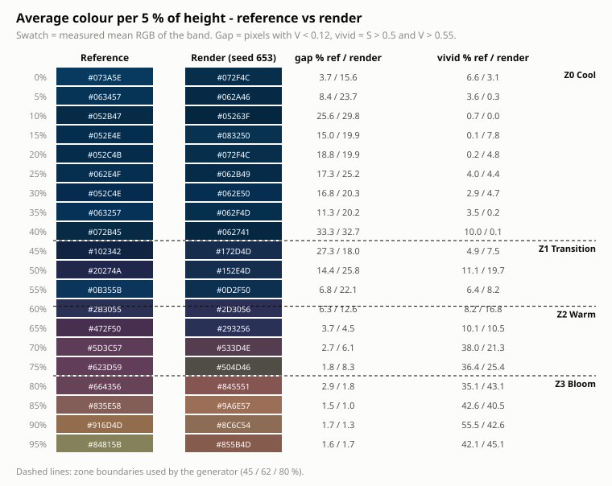

สิ่งที่อ่านได้:
- **0–40 %:** น้ำเงินเกือบ 100 % ความสว่างคงที่ (luminance 0.14–0.19) สีสดน้อยกว่า 10 %
- **40–50 %:** แถบที่มืดที่สุด (ร่องดำ 27–33 %) เป็นรอยต่อก่อนเปลี่ยนโทน
- **50–62 %:** ม่วง/แดงเริ่มแทรกเป็นก้อนเดี่ยว แต่ที่ 55 % กลับเป็นน้ำเงินเกือบล้วน (91 %) การเปลี่ยนสีจึง**ไม่เป็นเส้นตรง** มีจังหวะสลับ
- **65–80 %:** ม่วงชมพูกับ warm รวมกันราว 50 % สีสด 35–38 %
- **85–100 %:** สว่างที่สุด (luminance 0.40–0.50) สีสด 42–56 % และยังมีน้ำเงินเหลือ 15–20 %

### 2.5 กลุ่มสี (hue) ตามความสูง

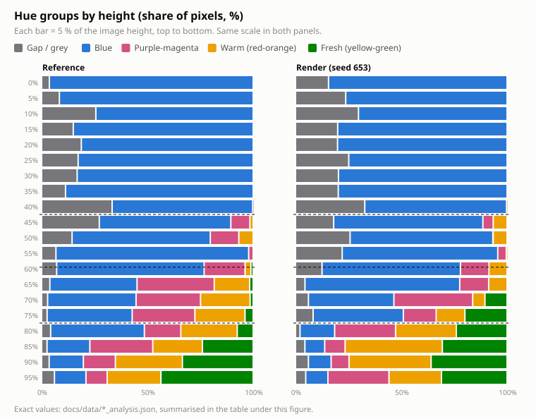

ตัวเลข (% ของพิกเซล: gap / blue / purple-magenta / warm / fresh):

| ความสูง | ภาพอ้างอิง | v2.0 (seed 653) | v2.1 (seed 653) | v2.2 (seed 653, cell 0.076) |
|---|---|---|---|---|
| 0% | 4 / 96 / 0 / 0 / 0 | 18 / 82 / 0 / 0 / 0 | 16 / 84 / 0 / 0 / 0 | 16 / 84 / 0 / 0 / 0 |
| 5% | 8 / 92 / 0 / 0 / 0 | 29 / 71 / 0 / 0 / 0 | 25 / 75 / 0 / 0 / 0 | 24 / 76 / 0 / 0 / 0 |
| 10% | 26 / 74 / 0 / 0 / 0 | 22 / 78 / 0 / 0 / 0 | 24 / 76 / 0 / 0 / 0 | 30 / 70 / 0 / 0 / 0 |
| 15% | 15 / 85 / 0 / 0 / 0 | 19 / 81 / 0 / 0 / 0 | 17 / 83 / 0 / 0 / 0 | 20 / 80 / 0 / 0 / 0 |
| 20% | 19 / 81 / 0 / 0 / 0 | 21 / 79 / 0 / 0 / 0 | 25 / 75 / 0 / 0 / 0 | 20 / 80 / 0 / 0 / 0 |
| 25% | 17 / 83 / 0 / 0 / 0 | 24 / 76 / 0 / 0 / 0 | 24 / 76 / 0 / 0 / 0 | 25 / 75 / 0 / 0 / 0 |
| 30% | 17 / 83 / 0 / 0 / 0 | 23 / 77 / 0 / 0 / 0 | 19 / 81 / 0 / 0 / 0 | 20 / 80 / 0 / 0 / 0 |
| 35% | 11 / 89 / 0 / 0 / 0 | 22 / 78 / 0 / 0 / 0 | 23 / 77 / 0 / 0 / 0 | 20 / 80 / 0 / 0 / 0 |
| 40% | 33 / 66 / 0 / 0 / 0 | 41 / 59 / 0 / 0 / 0 | 37 / 62 / 0 / 1 / 0 | 33 / 67 / 0 / 0 / 0 |
| 45% | 27 / 62 / 9 / 2 / 0 | 27 / 73 / 0 / 0 / 0 | 18 / 75 / 1 / 7 / 0 | 18 / 71 / 5 / 7 / 0 |
| 50% | 14 / 65 / 13 / 7 / 0 | 26 / 59 / 7 / 7 / 0 | 22 / 62 / 11 / 5 / 0 | 26 / 67 / 0 / 7 / 0 |
| 55% | 7 / 91 / 2 / 0 / 0 | 17 / 70 / 7 / 6 / 0 | 24 / 64 / 4 / 8 / 0 | 22 / 74 / 4 / 0 / 0 |
| 60% | 7 / 70 / 19 / 3 / 1 | 9 / 77 / 13 / 1 / 0 | 8 / 76 / 5 / 9 / 3 | 13 / 65 / 13 / 9 / 0 |
| 65% | 4 / 41 / 36 / 17 / 2 | 17 / 54 / 11 / 9 / 8 | 3 / 43 / 29 / 14 / 11 | 4 / 73 / 14 / 9 / 0 |
| 70% | 3 / 42 / 30 / 23 / 1 | 13 / 38 / 37 / 7 / 4 | 8 / 55 / 23 / 4 / 9 | 6 / 40 / 37 / 6 / 10 |
| 75% | 3 / 40 / 30 / 24 / 4 | 25 / 31 / 21 / 17 / 6 | 9 / 29 / 25 / 18 / 19 | 8 / 43 / 16 / 14 / 20 |
| 80% | 4 / 44 / 17 / 27 / 8 | 12 / 18 / 14 / 30 / 27 | 2 / 21 / 15 / 36 / 26 | 2 / 16 / 29 / 29 / 24 |
| 85% | 3 / 20 / 30 / 23 / 24 | 15 / 7 / 21 / 26 / 31 | 3 / 5 / 11 / 40 / 41 | 4 / 9 / 10 / 46 / 31 |
| 90% | 4 / 16 / 15 / 32 / 33 | 6 / 6 / 15 / 33 / 40 | 6 / 1 / 22 / 36 / 35 | 6 / 11 / 8 / 39 / 36 |
| 95% | 6 / 15 / 10 / 25 / 44 | 7 / 2 / 14 / 40 / 37 | 3 / 10 / 21 / 34 / 34 | 5 / 10 / 29 / 25 / 31 |

ข้อสังเกตจากการเทียบ (ตัวเลข gap ในตารางรวมพิกเซลเทา S < 0.2 ส่วนร่องดำด้านล่างนับเฉพาะ V < 0.12):

| ตัวชี้วัด | ภาพอ้างอิง | v2.0 (653 / 77) | v2.1 (653 / 77) | v2.2 (653 / 77) |
|---|---|---|---|---|
| ร่องดำเฉลี่ยแถบ 65–75 % (Z2) | 2.7 % | 18.1 / 14.0 % | 5.9 / 4.0 % | **6.3 / 7.4 %** |
| ร่องดำเฉลี่ยแถบ 80–95 % (Z3) | 1.9 % | 6.5 / 7.6 % | 1.4 / 1.6 % | **1.5 / 1.7 %** |
| น้ำเงินแถบ 80 / 85 / 90 / 95 % | 44 / 20 / 16 / 15 % | 18 / 7 / 7 / 2 · 21 / 7 / 2 / 6 % | 21 / 5 / 1 / 10 · 16 / 8 / 11 / 15 % | 16 / 9 / 11 / 11 · 19 / 8 / 10 / 5 % |
| น้ำเงินเฉลี่ย 80–100 % | 23.9 % | 8.3 / 8.8 % | 9.4 / 12.5 % | 11.7 / 10.2 % |

- **ร่องดำช่วงล่างลดลงใกล้ภาพอ้างอิงแล้ว** (R3) Z3 ต่ำกว่าเป้า 5 % ทุก seed ที่วัด ส่วน Z2 ยังสูงกว่าอ้างอิงราว 2–3 เท่า (cell ใหญ่ขึ้นใน v2.2 ทำให้ Z2 เพิ่มขึ้นเล็กน้อย)
- **น้ำเงินช่วงล่างเพิ่มขึ้นเพียงเล็กน้อย** (R2) ยังต่ำกว่าภาพอ้างอิงมาก การเพิ่มน้ำเงินมากกว่านี้ทำให้แถบ 0.9 มืดลงจนเกณฑ์สีของ `verify.ps1` ไม่ผ่าน (ดูข้อ 11)
- ช่วงบน 0–40 % และสัดส่วน warm/fresh ช่วงล่างใกล้เคียงกันดี

### 2.6 การแบ่งซ้าย/ขวาในช่วงล่าง

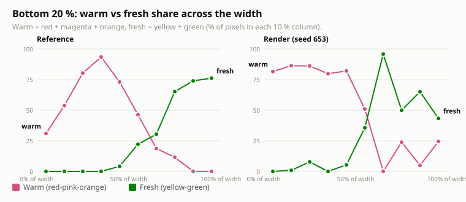

| คอลัมน์ (x) | อ้างอิง warm | อ้างอิง fresh | ที่สร้าง warm | ที่สร้าง fresh |
|---|---|---|---|---|
| 0–10% | 31 | 0 | 82 | 0 |
| 10–20% | 54 | 0 | 86 | 1 |
| 20–30% | 80 | 0 | 86 | 8 |
| 30–40% | 93 | 0 | 80 | 0 |
| 40–50% | 73 | 4 | 82 | 5 |
| 50–60% | 46 | 22 | 51 | 36 |
| 60–70% | 19 | 30 | 0 | 96 |
| 70–80% | 12 | 65 | 24 | 50 |
| 80–90% | 0 | 74 | 5 | 65 |
| 90–100% | 0 | 76 | 24 | 43 |

- จุดตัด warm/fresh ของทั้งสองภาพอยู่ราว **55–60 % ของความกว้าง** ตรงกับค่า `smoothstep(0.36, 0.62)` ที่ใช้อยู่
- ภาพอ้างอิงมี warm สูงสุดที่ 30–40 % และขอบซ้ายสุดยังเป็นน้ำเงิน (warm แค่ 31 %, น้ำเงิน 61 %) ส่วนภาพที่สร้างเป็น warm ตั้งแต่ขอบซ้าย (v2.0: 86 %, v2.1: 77 %, v2.2: 82 % น้ำเงิน 13 %) R2 แบบที่ใช้ (น้ำเงินกระจายทั้งแนวกว้าง) ยังไม่แก้จุดนี้ → R2b ในข้อ 11
- ตัวเลขภาพที่สร้างเป็นค่าของ v2.2 (seed 653) cell ที่ใหญ่ขึ้นทำให้คอลัมน์ขวาแกว่งมากขึ้น (warm 24 % ที่ 70–80 % และ 90–100 % มาจาก tile ชมพูไม่กี่ก้อน)

### 2.7 Palette

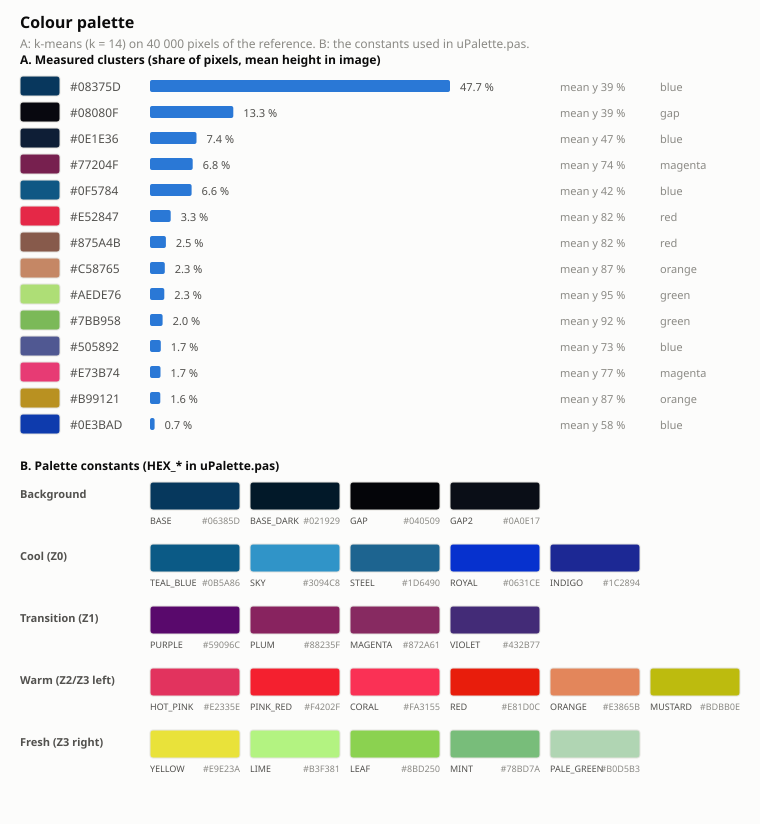

- 3 กลุ่มแรก (น้ำเงินหม่น + ดำ + น้ำเงินมืด) รวม **68 %** ของภาพ ภาพนี้จึงเป็น "ภาพน้ำเงินที่มีสีสดแต่งช่วงล่าง" ไม่ใช่ภาพหลากสี
- สีสดแต่ละสี (แดง ส้ม เขียว ชมพู) มีเพียง 1.6–3.3 % แต่ละสีมีตำแหน่งเฉลี่ยชัดเจน: ม่วงแดง ~74 %, แดง ~82 %, ส้ม ~87 %, เขียว ~92–95 %
- palette ในโค้ด (ส่วน B) ครอบคลุมทุก cluster ที่วัดได้

### 2.8 ขนาด tile และรายละเอียด

| ตัวชี้วัด | ภาพอ้างอิง | v2.0 (cell 0.068) | v2.1 (cell 0.068, R2 + R3) | **v2.2 (cell 0.076)** | ทดลอง cell 0.085 (ไม่รับ) |
|---|---|---|---|---|---|
| ระยะกริด = cell / ความสูง (%) | – | 3.8 | 3.8 | **4.3** | 4.8 |
| ระยะซ้ำแนวตั้งที่วัดได้ (% ของความสูง) | **5.9** | 3.8 | 3.1–3.4 | 4.8 (653: 8.5 = 2 เท่าของกริด) | 4.8–5.6 |
| ระยะซ้ำแนวนอน (% ของความกว้าง) | 13.5 | 7.7–9.5 | 7.6–7.9 | 7.9–15.7 | 9.6–17.2 |
| ขอบ (Sobel) Z0 / Z1 / Z2 / Z3 (%) | 4.8 / 5.1 / 9.8 / 13.1 | 6.0 / 8.6 / 11.3 / 15.0 | 5.9 / 8.0 / 12.0 / 14.1 | 5.5 / 7.4 / 9.9 / 13.0 | 5.1 / 6.9 / 9.7 / 12.5 |
| ความต่างสีเฉลี่ยต่อแถบ (max channel, เฉลี่ย 20 แถบ) | – | 13.4–16.2 | 13.9–14.2 | 13.2–13.4 | 15.0–17.4 |
| เกณฑ์สี 16 seed (R11): bias สูงสุด (≤ 15) | – | 15.0 | 13 | **11** | 17 ❌ (แถบ 0.6 แดงเกิน) |
| เกณฑ์สี 16 seed: median ของ worst (≤ 25) | – | 21.0 | 19.5 | **21.5** | 23.0 |
| เกณฑ์สี 16 seed: worst สูงสุด (≤ 40) | – | 32 | 31 | **30** | 41 ❌ |
| เกณฑ์เดิม: worst ของ 4 seed (≤ 25, ใช้ถึง v2.1) | – | 22 | 21 | 24 | 26 |

ค่าในคอลัมน์ภาพที่สร้างเป็นช่วงของ seed 653 และ 77 ส่วนแถว 16 seed ใช้ seed 653, 77, 1234, 9, 1–8, 11–14 คอลัมน์ 0.085 วัดบนโค้ด v2.2 (รวม R2 + R3)

- ภาพที่สร้างมี tile **ถี่กว่า** ภาพอ้างอิงราว 1.5 เท่าในแนวตั้ง แต่ cell ที่ใหญ่ขึ้นทำให้ tile น้อยลง แถบ ±3 % ของเกณฑ์สีจึงครอบคลุมแค่ราว 1 แถว tile และค่าแกว่งตาม seed มาก เกณฑ์เดิม (4 seed, worst ≤ 25) จึงแยกผลของ cell ออกจากการสุ่มไม่ได้ ข้อ 10 ใช้เกณฑ์ 16 seed (R11) แทนตั้งแต่ v2.2
- กวาด cell บนโค้ด v2.1 ด้วยเกณฑ์ใหม่: 0.072 ผ่าน (bias 12 / median 20.0 / max 35), **0.076 ผ่านโดยมีระยะเผื่อมากที่สุด** (11 / 21.5 / 30), 0.080 พอดีขอบทั้งสองเกณฑ์ (15.0 / 23.0 / 40), 0.085 ไม่ผ่าน (17 / 23.0 / 41) bias แดงที่แถบ 0.6 เพิ่มตาม cell (+11 → +17) เป็นความเพี้ยนจริง ไม่ใช่สุ่ม จึงเลือก 0.076
- ระยะซ้ำที่วัดด้วย autocorrelation แกว่งมาก (บางครั้งจับได้ 2 เท่าของกริด และลดลงเมื่อร่องดำหายไปแม้กริดไม่เปลี่ยน) จึงเพิ่มแถว "ระยะกริด" ซึ่งเป็นค่าที่ตั้งจริง เป้า 5.9 % ต้องใช้ cell ราว 0.10 ซึ่งยังไม่ได้ทดลอง

### 2.9 สรุป: ลักษณะที่ต้องเลียนแบบ

| # | ลักษณะ | สถานะ |
|---|---|---|
| 1 | พื้นน้ำเงิน `#06385D`–`#08375D` ครองครึ่งบนเกือบทั้งหมด | ✅ ทำแล้ว |
| 2 | ร่องดำรูปแฉก หนาแน่นสุดที่ 40–50 % | ✅ ทำแล้ว (hole chance เพิ่มรอบ y = 0.5) |
| 3 | ไล่สีแนวตั้ง 4 โซน แบบไม่เป็นเส้นตรง | ✅ ทำแล้ว (smoothstep + fbm noise) |
| 4 | ช่วงล่างแบ่งซ้ายแดง/ขวาเขียว ตัดที่ ~55 % | ✅ ทำแล้ว |
| 5 | Tile มุมมน มีขอบเข้ม แสงสะท้อน เงา | ✅ ทำแล้ว (ข้อ 3.4) |
| 6 | ก้อนหลอมเป็นกลุ่ม (L / แท่ง) | ✅ ทำแล้ว (bridges ช่วง y > 0.6) |
| 7 | ระยะ tile 5.9 % ของความสูง | 🔶 บางส่วน (R1, v2.2): cell 0.076 → ระยะกริด 4.3 % (เดิม 3.8 %) 0.085 ไม่ผ่านเกณฑ์สี → R12 |
| 8 | น้ำเงินยังเหลือ 15–44 % ช่วงล่าง | 🔶 บางส่วน: 9–16 % (seed 653), 5–19 % (seed 77) เดิม 2–21 % → R2 ทำแล้วบางส่วน, R2b |
| 9 | ร่องดำแทบไม่มีช่วงล่าง (< 3 %) | ✅ ทำแล้ว (R3): Z3 1.5–1.7 %, Z2 6.3–7.4 % (เดิม 6.5–18.1 %) |
| 10 | รูปทรงไม่สม่ำเสมอ ไม่เห็นเป็นกริด | ⚠️ ยังเห็นกริด → R4 |
| 11 | สีลามข้ามขอบ (bleed) | 🔶 บางส่วน (glow mode 2) → R5 |

---

## 3. การออกแบบ (Design spec)

### 3.1 Zone map

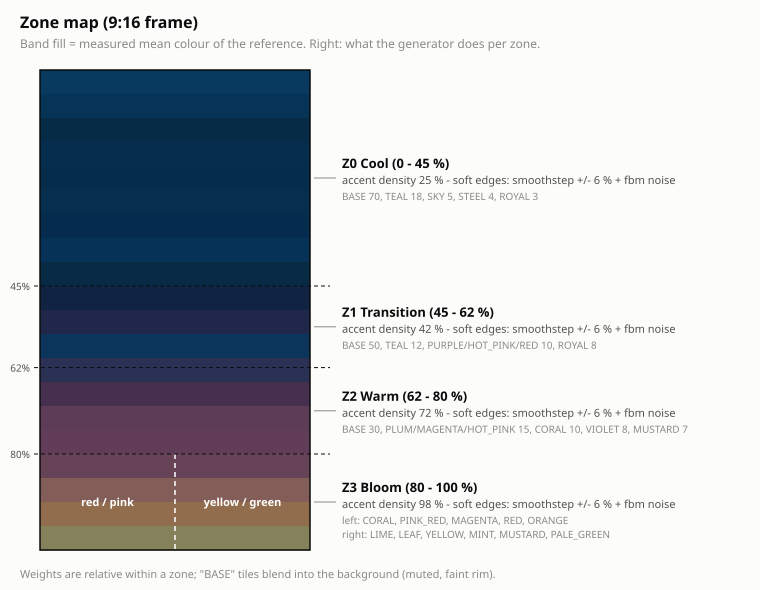

| โซน | ช่วง y | ความหนาแน่น accent | น้ำหนักสี (สัมพัทธ์ในโซน) |
|---|---|---|---|
| Z0 Cool | 0.00–0.45 | 0.25 | BASE 70, TEAL_BLUE 18, SKY 5 ★, STEEL 4, ROYAL 3 ★ |
| Z1 Transition | 0.45–0.62 | 0.42 | BASE 50, TEAL_BLUE 12, PURPLE 10 ★, HOT_PINK 10 ★, RED 10 ★, ROYAL 8 ★ |
| Z2 Warm | 0.62–0.80 | 0.72 | BASE 30, PLUM 15 ★, MAGENTA 15 ★, HOT_PINK 15 ★, CORAL 10 ★, VIOLET 8 ★, MUSTARD 7 ★ |
| Z3 Bloom ซ้าย | 0.80–1.00 | 0.98 | CORAL 22, PINK_RED 22, MAGENTA 20, RED 18, ORANGE 18 (★), TEAL_BLUE 10 |
| Z3 Bloom ขวา | 0.80–1.00 | 0.98 | LIME 20, LEAF 20, YELLOW 18, MINT 16, MUSTARD 14, PALE_GREEN 12 (★), TEAL_BLUE 10 |

★ = vivid (tile สีสด มีขอบเข้ม, glint 70 %, glow ถ้า y > 0.42) · สีที่ไม่มี ★ = tile แบบ muted (กลืนกับพื้น ขอบจาง glint 25 %)

- **ขอบโซนนุ่ม:** น้ำหนักของแต่ละโซนคำนวณด้วย `smoothstep(edge − 0.06, edge + 0.06, y)` ที่ขอบ 0.45 / 0.62 / 0.80
- **ขอบโซนไม่ตรง:** ใช้ `y' = y + (fbm(3x + 5.3, 3y + 1.7) − 0.5) × ZoneNoise × 2` (ZoneNoise = 0.08)
- **ซ้าย/ขวาใน Z3:** โอกาสได้สีฝั่งขวา = `smoothstep(0.36, 0.62, x + (noise(4x + 17, 4y) − 0.5) × 0.25)`

### 3.2 ค่าสี (uPalette.pas)

```pascal
// พื้นหลัง / ร่อง
HEX_BASE = $06385D;  HEX_BASE_DARK = $021929;  HEX_GAP = $040509;  HEX_GAP2 = $0A0E17;
// Cool
HEX_TEAL_BLUE = $0B5A86;  HEX_SKY = $3094C8;  HEX_STEEL = $1D6490;  HEX_ROYAL = $0631CE;  HEX_INDIGO = $1C2894;
// Transition
HEX_PURPLE = $59096C;  HEX_PLUM = $88235F;  HEX_MAGENTA = $872A61;  HEX_VIOLET = $432B77;
// Warm
HEX_HOT_PINK = $E2335E;  HEX_PINK_RED = $F4202F;  HEX_CORAL = $FA3155;  HEX_RED = $E81D0C;
HEX_ORANGE = $E3865B;  HEX_MUSTARD = $BDBB0E;
// Fresh
HEX_YELLOW = $E9E23A;  HEX_LIME = $B3F381;  HEX_LEAF = $8BD250;  HEX_MINT = $78BD7A;  HEX_PALE_GREEN = $B0D5B3;
```

### 3.3 ชนิดของ tile

| ชนิด | Layer | ขนาด (× cell) | ความมน | สี | หมายเหตุ |
|---|---|---|---|---|---|
| Hole (เงาในร่อง) | 1 | 0.45–0.70 | 0.9 | BASE_DARK α170 | โอกาส = HoleChance × (1 + e^(−((y−0.5)/0.1)²)) และ × 0.2 เมื่อ y > 0.62 |
| Base blob | 1 | กว้าง 0.95–1.20, สูง 0.92–1.18 | 0.55–0.80 | BASE × 0.92–1.07 | ใหญ่กว่า cell จึงทับกันจนเหลือร่องแฉก ขยาย × 1.1 เมื่อ y > 0.62 ช่วงล่างมีโอกาส `clamp((y − 0.55) × 2.2, 0, 0.85)` ที่จะผสมสีโซน 40–65 % |
| Accent (muted) | 2 | กว้าง 0.72–0.95, สูง 0.70–0.92, × grow | 0.40–0.65 | สีโซนที่ไม่มี ★ | ขอบ α120, shade α70 · grow = 1 + 0.35 × smoothstep(0.78, 1.0, y) ให้ tile ช่วงล่างชิดกัน |
| Accent (vivid) | 2 | เท่ากัน | 0.40–0.65 | สีโซนที่มี ★ | ขอบ α215, shade α150, glow |
| Bridge | 2 | หนา 0.9 × ด้านที่สั้นกว่า | 0.5 | สีเฉลี่ยของคู่ | 30 % ของ accent สีสด (★) ที่ y > 0.6 เชื่อมกับเพื่อนบ้านขวาหรือล่าง |

ตำแหน่ง: กริด `cell = max(12, round(W × CellRatio))` เลื่อนแบบสุ่ม (jitter) base ±0.24 cell, accent ±JitterPos (0.22) cell

### 3.4 องค์ประกอบของ tile

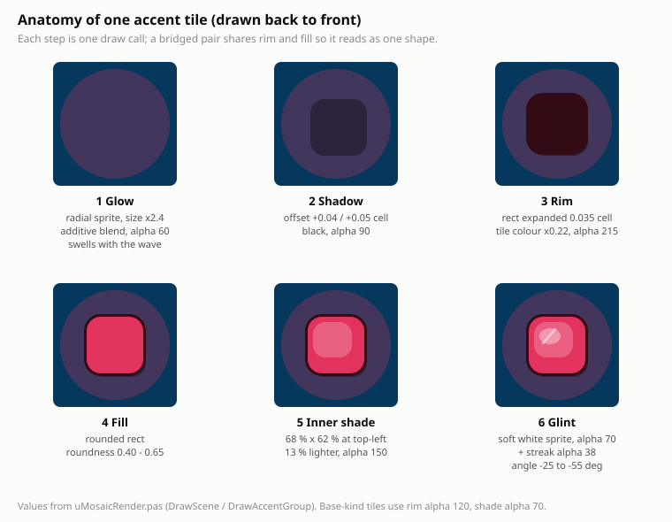

### 3.5 การเคลื่อนไหว

ทุกการเคลื่อนไหวคูณด้วยค่า **Motion** (0–300 %, ค่าเริ่มต้น 100 %) ค่า φ คือเฟสสุ่มของแต่ละ tile และ `wave` คือคลื่นที่วิ่งทแยงผ่านทั้งภาพ

| เอฟเฟกต์ | สูตร (ที่ Motion = m) | Accent | Base | ความรู้สึก |
|---|---|---|---|---|
| Travelling wave | `wave = sin(1.6t − (cx + 0.8·cy)/cell × 0.9)` | ✔ | ✔ | คลื่นแสงวิ่งลงขวา ยาว ~7 cell รอบละ ~3.9 วินาที |
| Breathing (ขนาด) | `1 + m·amp·(sin(1.6t + φ) + 0.8·wave)` | amp 0.06 | amp 0.025 | ก้อนพองยุบ |
| Drift (ตำแหน่ง) | `m·d·cell·(sin(0.9t + 1.3φ), cos(0.7t + φ))` | d 0.10 | d 0.04 | ก้อนลอยเบาๆ |
| Twinkle + crest (สี) | `× (1 + m·(0.08·sin(2t + φ) + 0.12·wave))` | ✔ | – | ระยิบและสว่างตามคลื่น |
| Glow pulse | `alpha × (1 + 0.6·m·wave)` | ✔ (glow) | – | แสงฟุ้งพองตามคลื่น |
| Gradient scroll (ปิดไว้) | `lerp(color, color2, 0.5 + 0.5·sin(0.6t − 4y))` | ✔ | – | สีไหลลงช้าๆ |

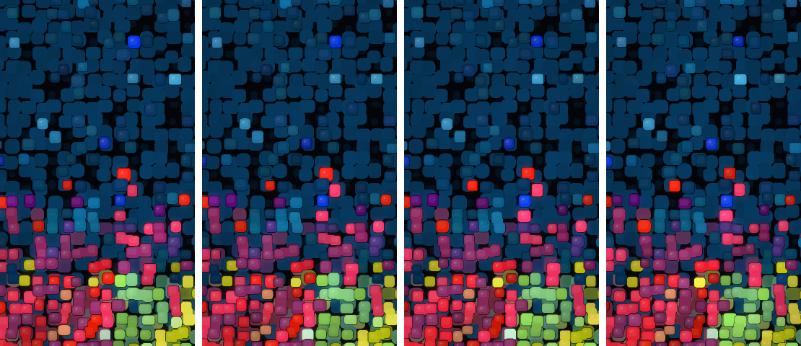

*4 เฟรม t = 0, 0.5, 1.0, 1.5 วินาที ที่ Motion 100 % มีพิกเซลเปลี่ยน 11.7 % ทุก 0.5 วินาที*

---

## 4. อัลกอริทึม

### 4.1 การสร้างฉาก (GenerateMosaic)

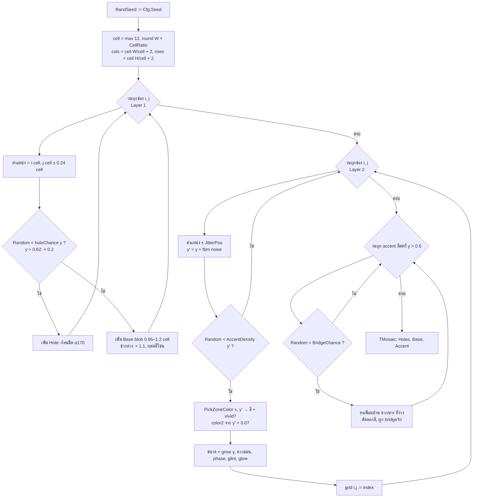

**กฎ deterministic:** ใช้ `Random` เฉพาะใน `GenerateMosaic` เท่านั้น ค่าที่ใช้ตอนวาด (phase, มุม glint ฯลฯ) เก็บไว้ใน `TTile` ตั้งแต่ตอนสร้าง seed เดียวกันจึงได้ภาพเดียวกันทุกไบต์

### 4.2 การวาดแต่ละเฟรม (DrawScene)

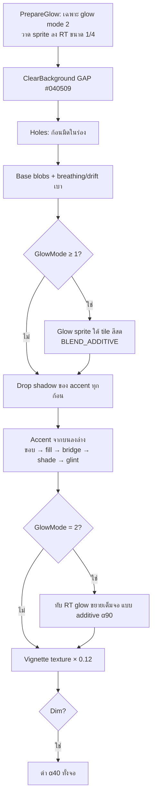

| Glow mode | วิธีทำ | ผล |
|---|---|---|
| 0 | ไม่มี | คมที่สุด เร็วที่สุด |
| 1 (ค่าเริ่มต้น) | radial gradient sprite (texture 64×64 ที่สร้างเอง) ใต้ tile สีสด | แสงฟุ้งรอบก้อน |
| 2 | mode 1 + วาด sprite ลง RenderTexture 1/4 แล้วขยายแบบ bilinear ทับแบบ additive | สีลามคล้ายภาพจริงมากขึ้น |

### 4.3 สูตรการเคลื่อนไหวในโค้ด

```pascal
// uMosaicRender.pas
function TMosaicRenderer.Wave(const T: TTile; time, cell: Single): Single;
begin
  Result := Sin(time * 1.6 - (T.cx + T.cy * 0.8) / cell * 0.9);
end;

// TileRect: amp/drift เป็นสัดส่วนของขนาด tile / cell ที่ Motion = 1
s  := 1 + m * amp * (Sin(time * 1.6 + T.phase) + 0.8 * Wave(T, time, cell));
dx := m * drift * cell * Sin(time * 0.9 + T.phase * 1.3);
dy := m * drift * cell * Cos(time * 0.7 + T.phase);
```

---

## 5. สถาปัตยกรรมซอฟต์แวร์

### 5.1 ไฟล์และหน้าที่

| ไฟล์ | หน้าที่ | ขึ้นกับ |
|---|---|---|
| `raylib.pas` | binding raylib ขั้นต่ำ (window, input, shapes, textures, render texture, blend, image export) | raylib.dll |
| `uMosaicTypes.pas` | `TTile`, `TMosaic`, `TMosaicConfig` + ค่าเริ่มต้น | raylib (TColor) |
| `uNoise.pas` | value noise + fbm แบบ deterministic | – |
| `uPalette.pas` | ค่าสี, น้ำหนักโซน, ความหนาแน่น, สุ่มสี, ฟังก์ชันสี | uNoise |
| `uMosaicGen.pas` | `GenerateMosaic`: สร้าง holes / base / accent / bridges | uPalette, uNoise |
| `uMosaicRender.pas` | `TMosaicRenderer`: วาดฉาก, glow, vignette, นับ draw call | raylib, uPalette |
| `uMosaicStats.pas` | ประวัติเวลา 600 เฟรม, สรุปค่า, event log, CSV | – |
| `uMosaicEngine.pas` | `TMosaicEngine`: หน้าต่าง, loop, คีย์, HUD, bake/fade, คิวคำสั่ง, export, lock | ทุก unit ข้างบน |
| `uMosaicReport.pas` | รายการสถานะ + export JSON/TXT | engine, uSysInfo |
| `uSysInfo.pas` | RAM, GPU/OpenGL, OS, CPU, ข้อมูล DLL/exe | Windows API |
| `uDevForm.pas` + `.lfm` | หน้าต่างนักพัฒนา (LCL) + `TRenderThread` | LCL, engine |
| `MosaicWall.lpr` | โปรแกรมหลัก + CLI | engine |
| `MosaicWallDev.lpr` | โปรแกรมนักพัฒนา (LCL) | uDevForm |

### 5.2 Class diagram

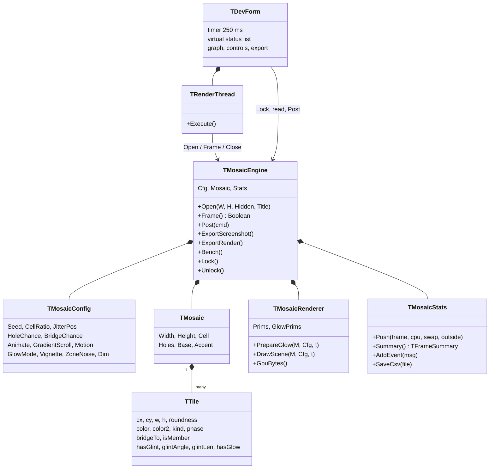

### 5.3 Frame loop

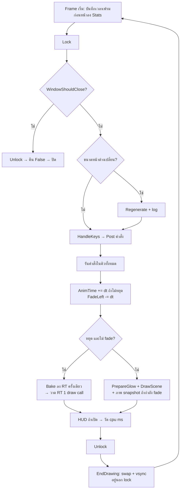

### 5.4 Thread model (MosaicWallDev)

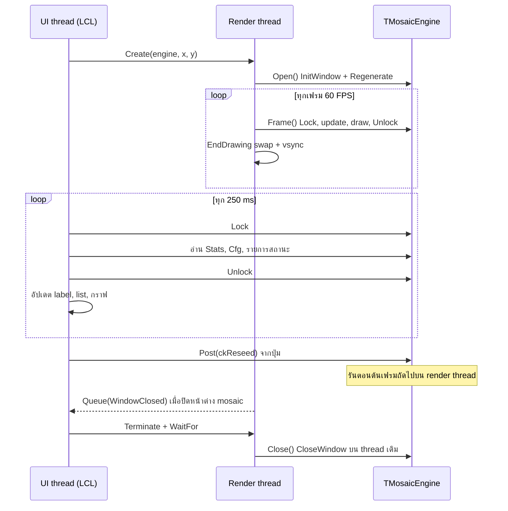

**เหตุผลที่แยก thread:** ตอนแรก raylib กับฟอร์มรันบน main thread เดียวกัน (`Application.OnIdle`) ผลคือ raylib ไปประมวลผลข้อความ repaint ของฟอร์มระหว่าง `EndDrawing` ทำให้เฟรมยาว 27–30 ms ทุก 250 ms (12 ครั้งใน ~3 วินาที) ทดลองแยกสาเหตุแล้ว: ปิด vsync ก็ยังเกิด ส่วนหน้าต่างของ process อื่นที่ repaint 4 ครั้ง/วินาทีไม่ทำให้เกิด หลังแยก thread: **0 เฟรมเกิน 20 ms, p99 16.9 ms**

**กฎการใช้ engine จาก thread อื่น:**
- เรียก raylib ได้เฉพาะบน render thread
- thread อื่นอ่านค่าระหว่าง `Lock/Unlock` และเปลี่ยนค่าผ่าน `Post()` เท่านั้น
- lock เป็น critical section แบบ re-entrant (Windows) จึงเรียก `Log` หรือ `Post` ซ้อนในขณะถือ lock ได้

### 5.5 คำสั่งของ engine (`Post`)

| คำสั่ง | พารามิเตอร์ | ผล |
|---|---|---|
| `ckReseed` | – | snapshot ภาพ → seed ถัดไป (LCG) → cross-fade 0.6 s |
| `ckSetSeed` | I1 = seed | เหมือนข้างบนแต่กำหนด seed เอง |
| `ckSetCell` | F = ratio | 0.04–0.12 แล้ว regenerate |
| `ckSetGlow` | I1 = 0..2 | glow mode |
| `ckSetMotion` | F = 0..3 | ความแรงการเคลื่อนไหว |
| `ckSetPaused` | B | หยุด/เล่น (ตอนหยุด = bake) |
| `ckSetScroll` / `ckSetVignette` / `ckSetDim` / `ckSetHud` | B | เปิด/ปิด |
| `ckFullscreen` | – | สลับเต็มจอ |
| `ckWindowSize` | I1, I2 | เปลี่ยนขนาดหน้าต่าง |
| `ckExportScreenshot` | S = ไฟล์ (ว่าง = ตั้งชื่ออัตโนมัติ) | PNG ขนาดหน้าต่าง (ไม่มี HUD) |
| `ckExportRender` | I1, I2 (S ไม่บังคับ) | PNG ความละเอียดใดก็ได้ (seed เดียวกัน) |

### 5.6 ข้อควรรู้เกี่ยวกับ raylib

- `raylib.dll` ต้องเป็นรุ่น 5.5 ขึ้นไป (export `DrawRectangleRoundedLinesEx`)
- ไม่ใช้ `DrawCircleGradient` เพราะ signature ต่างกันในแต่ละรุ่น ใช้ texture gradient ที่สร้างเองแทน
- RenderTexture เก็บภาพกลับหัว ต้องวาดด้วย source height ติดลบ (`DrawRenderTexture`)
- alpha ใน RenderTexture ลดลงตรงที่วาดรูปโปร่งแสง จึงวาดภาพ bake ด้วย `BLEND_ALPHA_PREMULTIPLY` และแปลงเป็น RGB (ตัด alpha) ก่อน export PNG
- ทั้งสองโปรแกรมเป็น GUI app (`{$APPTYPE GUI}`) จึงไม่มีหน้าต่าง console สีดำ ข้อความ CLI เขียนผ่าน `GetStdHandle` ซึ่งยังออก stdout ได้เมื่อรันจาก terminal

---

## 6. MosaicWallDev — หน้าต่างสถานะสำหรับนักพัฒนา

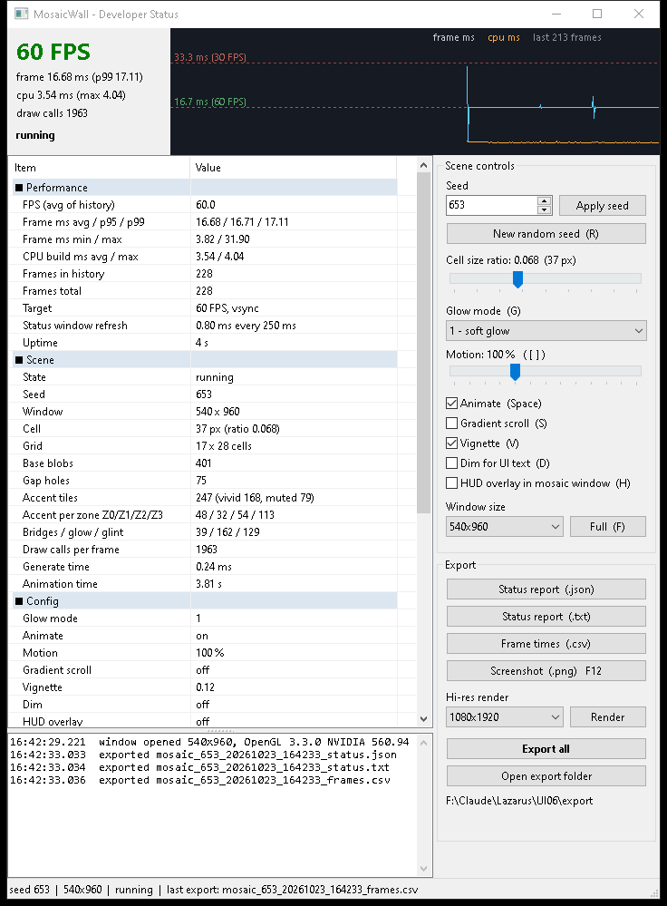

### 6.1 ส่วนประกอบของหน้าต่าง

| ส่วน | รายละเอียด |
|---|---|
| **แถบบน** | FPS (เขียว ≥ 55 / ส้ม ≥ 30 / แดง), frame ms + p99, cpu ms, draw calls, สถานะ · กราฟเวลาเฟรม (ฟ้า = frame, ส้ม = cpu) พร้อมเส้น 16.7 และ 33.3 ms |
| **ตารางสถานะ** | 6 หมวด อัปเดตทุก 250 ms (ข้อ 6.2) · ใช้ `TListView` แบบ OwnerData อัปเดตเสร็จในเวลาไม่ถึง 1 ms |
| **Event log** | ทุกการเปลี่ยนแปลงมีเวลากำกับถึงมิลลิวินาที (เก็บ 500 บรรทัดล่าสุด) |
| **Scene controls** | seed (กำหนดเอง/สุ่ม), cell ratio, glow mode, **Motion 0–300 %**, animate, gradient scroll, vignette, dim, HUD, ขนาดหน้าต่าง, fullscreen · ซิงก์กับปุ่มคีย์บอร์ดในหน้าต่าง mosaic ทั้งสองทาง |
| **Export** | JSON, TXT, CSV, screenshot PNG, hi-res PNG, Export all, เปิดโฟลเดอร์ |

### 6.2 รายการสถานะ

| หมวด | รายการ |
|---|---|
| Performance | FPS, frame ms avg/p95/p99, min/max, CPU build ms avg/max, จำนวนเฟรม, target, เวลา refresh ของหน้าต่างสถานะ, uptime |
| Scene | state, seed, window, cell (px + ratio), grid, base blobs, gap holes, accent (vivid/muted), accent ต่อโซน Z0–Z3, bridges/glow/glint, draw calls ต่อเฟรม, เวลา generate, animation time |
| Config | glow, animate, motion, gradient scroll, vignette, dim, HUD, jitter/hole/bridge, zone noise |
| Resources | GPU texture (ประมาณ), RAM working set / peak / private |
| System | GPU, vendor, OpenGL, raylib.dll (ขนาด/วันที่), OS, CPU threads, build |
| Export | โฟลเดอร์, ไฟล์ล่าสุด |

### 6.3 รูปแบบไฟล์ export

ไฟล์ทั้งหมดอยู่ใน `export\` ข้าง exe ชื่อไฟล์ `mosaic_<seed>_<yyyymmdd_hhnnss>_<ชนิด>.<ext>`

| ปุ่ม | ไฟล์ | เนื้อหา |
|---|---|---|
| Status report (.json) | `_status.json` | `config` (ค่าดิบ), ทุกหมวดสถานะ, `frameHistory.frameMs/cpuMs`, `events` |
| Status report (.txt) | `_status.txt` | รายงานอ่านง่าย + event log |
| Frame times (.csv) | `_frames.csv` | `sample, frame_ms, cpu_ms, swap_ms, outside_ms` |
| Screenshot (.png) / F12 | `_screen.png` | ภาพฉากปัจจุบันขนาดหน้าต่าง (ไม่มี HUD) |
| Render | `_1080x1920.png` ฯลฯ | 1080×1920 / 1440×2560 / 2160×3840 |
| Export all | ทั้งหมดข้างบน | – |

ตัวอย่าง JSON (ย่อ):

```json
{
  "app": "MosaicWall",
  "generated": "2026-10-23T16:22:31",
  "config": { "seed": 653, "cellRatio": 0.068, "glowMode": 1, "motion": 1, "paused": false, "width": 540, "height": 960 },
  "Performance": { "FPS (avg of history)": "60.1", "Frame ms avg / p95 / p99": "16.64 / 16.76 / 16.88" },
  "Scene": { "Seed": "653", "Accent tiles": "247 (vivid 168, muted 79)" },
  "frameHistory": { "frameMs": [16.506, 9.403], "cpuMs": [4.739, 4.477] },
  "events": ["16:22:27.969  window opened 540x960, OpenGL 3.3.0 NVIDIA 560.94"]
}
```

ความหมายของคอลัมน์ CSV: `frame_ms` = เวลาเต็มเฟรม · `cpu_ms` = เวลาเตรียมและวาด (ก่อน swap) · `swap_ms` = เวลาใน `EndDrawing` (swap + vsync + รับ event) · `outside_ms` = เวลานอก `Frame` (งานของโปรแกรมแม่)

---

## 7. การติดตั้ง

### 7.1 ความต้องการของระบบ

| รายการ | ขั้นต่ำ | ที่ทดสอบแล้ว |
|---|---|---|
| OS | Windows 10 x64 | Windows 10 build 19045 |
| IDE / Compiler | Lazarus 3.x + FPC 3.2.x (Win64) | Lazarus 3.4, FPC 3.2.2 |
| raylib | `raylib.dll` 5.5 x64 (มีในโฟลเดอร์โปรเจกต์แล้ว) | raylib.dll 1770 KB |
| GPU | OpenGL 3.3 | NVIDIA GeForce GTX 1650, driver 560.94 |
| เครื่องมือวิเคราะห์ (ไม่บังคับ) | PowerShell 5.1, Python 3 (ไม่ต้องลง package เพิ่ม), Microsoft Edge สำหรับแปลง SVG เป็น PNG | – |

### 7.2 ขั้นตอนติดตั้ง

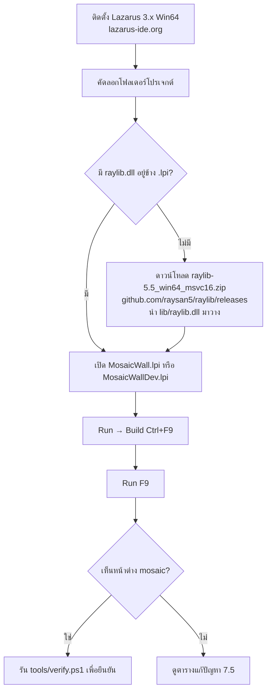

1. ติดตั้ง **Lazarus 3.x สำหรับ Windows 64-bit** จาก lazarus-ide.org (FPC มาพร้อมกัน) ใช้โฟลเดอร์ปกติ `C:\lazarus`
2. คัดลอกโฟลเดอร์ `UI06` ทั้งโฟลเดอร์ (ต้องมี `raylib.dll` อยู่ข้างไฟล์ `.lpi`)
3. ถ้าไม่มี `raylib.dll` ให้ดาวน์โหลด `raylib-5.5_win64_msvc16.zip` จากหน้า releases ของ raysan5/raylib แล้วนำ `lib\raylib.dll` มาวาง (ต้องเป็นรุ่น **x64** เท่านั้น)
4. เปิด `MosaicWallDev.lpi` (หรือ `MosaicWall.lpi`) ใน Lazarus → **Run → Build** แล้ว **Run**

### 7.3 Build ด้วย command line

```bash
C:/lazarus/lazbuild.exe MosaicWall.lpi
```

```bash
C:/lazarus/lazbuild.exe MosaicWallDev.lpi
```

ผลลัพธ์: `MosaicWall.exe` (~350 KB) และ `MosaicWallDev.exe` (~2.8 MB) ส่วนไฟล์ object อยู่ในโฟลเดอร์ `lib\`

### 7.4 นำไปใช้บนเครื่องอื่น (deploy)

คัดลอกเพียง **`MosaicWall.exe` หรือ `MosaicWallDev.exe` คู่กับ `raylib.dll`** ไว้ในโฟลเดอร์เดียวกัน ไม่ต้องติดตั้งอะไรเพิ่ม (โฟลเดอร์ `export\` จะถูกสร้างเองตอน export ครั้งแรก) เครื่องปลายทางต้องรองรับ OpenGL 3.3

### 7.5 แก้ปัญหา

| อาการ | สาเหตุ | วิธีแก้ |
|---|---|---|
| มีหน้าต่างดำอีกหน้าต่างโผล่ขึ้นมา | build เป็น console app | ตรวจว่ามี `{$APPTYPE GUI}` หรือ `GraphicApplication = True` ใน .lpi (ทั้งสองโปรเจกต์ตั้งไว้แล้ว) |
| "raylib.dll was not found" | ไม่มี DLL ข้าง exe | วาง `raylib.dll` x64 ไว้ในโฟลเดอร์เดียวกับ exe |
| ปิดทันทีหรือมี error เรื่อง OpenGL | ไดรเวอร์จอไม่รองรับ OpenGL 3.3 หรือรันผ่าน Remote Desktop | อัปเดตไดรเวอร์ และรันบนเครื่องจริง |
| Link error "Can't create object file … (error code: 5)" | exe ยังเปิดอยู่ | ปิดโปรแกรมก่อน build |
| ภาพกระตุกเป็นจังหวะ | งาน UI อยู่บน thread เดียวกับ raylib | ใช้โครงสร้าง render thread แบบ MosaicWallDev (ข้อ 5.4) |
| กระตุก 1 ครั้งตอน export hi-res | การเรนเดอร์ 1080×1920 ขึ้นไปทำบน render thread (~200 ms) | เป็นพฤติกรรมปกติ ดู R8 |
| ข้อความ CLI (`--bench`, `--shot`) ไม่แสดง | GUI app ไม่มี console ของตัวเอง | รันจาก terminal (PowerShell/bash) ข้อความจะออกทาง stdout |
| ตัวอักษรไทยในกราฟ SVG ไม่แสดง | เครื่องไม่มีฟอนต์ไทย | กราฟใช้ Leelawadee UI / Tahoma ซึ่งมากับ Windows |

---

## 8. การใช้งาน

### 8.1 ปุ่มในหน้าต่าง mosaic (ทั้งสองโปรแกรม)

| ปุ่ม | การทำงาน |
|---|---|
| `R` | สุ่ม seed ใหม่ (cross-fade 0.6 s) |
| `Space` / `P` | หยุด/เล่น (ตอนหยุดจะ bake ภาพ ใช้ 1 draw call) |
| `G` | สลับ glow 0 → 1 → 2 |
| `+` / `-` | ขยาย/ย่อ cell ครั้งละ 0.005 (0.04–0.12) |
| `[` / `]` | ลด/เพิ่ม Motion ครั้งละ 25 % (0–300 %) |
| `S` | Gradient scroll |
| `V` | Vignette |
| `D` | Dim (สำหรับวางตัวหนังสือทับ) |
| `F` | Fullscreen |
| `H` | HUD (ค่าและคำอธิบายปุ่มบนภาพ) |
| `F12` | Export PNG ลง `export\` |
| `Esc` | ออก |

### 8.2 Command line ของ MosaicWall.exe

| ตัวเลือก | ความหมาย | ค่าเริ่มต้น |
|---|---|---|
| `--seed N` | seed เริ่มต้น | 653 |
| `--size WxH` | ขนาดหน้าต่าง | 540x960 |
| `--glow N` | glow mode 0/1/2 | 1 |
| `--motion P` | ความแรงการเคลื่อนไหว 0–300 (%) | 100 |
| `--cell R` | ขนาด cell เป็นสัดส่วนของความกว้าง 0.04–0.12 | 0.076 |
| `--static` | เริ่มแบบหยุด | – |
| `--shot FILE.png` | เรนเดอร์ 1 ภาพแล้วออก (ไม่เปิดหน้าต่างให้เห็น) | – |
| `--render WxH` | ขนาดภาพของ `--shot` / `--bench` | 1080x1920 |
| `--time T` | เวลา animation ของภาพจาก `--shot` | 0 |
| `--bench N` | วัดความเร็ว N เฟรมแล้วพิมพ์ผล | – |

`MosaicWallDev.exe --selftest` จะกด Export all หลัง 4 วินาที แล้วปิดตัวเองหลัง 7 วินาที (ใช้ตรวจอัตโนมัติ)

### 8.3 ตัวอย่างงานที่ใช้บ่อย

สร้าง wallpaper 4K แนวตั้ง:

```bash
./MosaicWall.exe --shot wallpaper_4k.png --render 2160x3840 --seed 653
```

สร้างหลายแบบเพื่อเลือก:

```bash
for s in 1 2 3 4 5; do ./MosaicWall.exe --shot pick_$s.png --render 1080x1920 --seed $s; done
```

วัดความเร็วบนเครื่องเป้าหมาย:

```bash
./MosaicWall.exe --bench 300 --glow 2 --render 1440x2560
```

**Workflow การปรับค่าด้วย MosaicWallDev:**

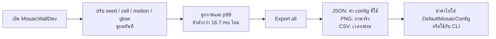

---

## 9. นำไปใช้ในโปรเจกต์อื่น

### 9.1 ใช้เป็นฉากหลังของโปรแกรม raylib อื่น (ระดับ renderer)

ใช้แค่ `uMosaicTypes`, `uMosaicGen` และ `uMosaicRender` (ซึ่งต้องใช้ `uPalette` และ `uNoise`) ไม่ต้องใช้ engine:

```pascal
uses raylib, uMosaicTypes, uMosaicGen, uMosaicRender;

var
  Cfg: TMosaicConfig;
  M: TMosaic;
  R: TMosaicRenderer;
begin
  InitWindow(1280, 720, 'My App');
  SetTargetFPS(60);
  Cfg := DefaultMosaicConfig;
  Cfg.Dim := True;          // ให้ตัวหนังสือที่วางทับอ่านง่าย
  Cfg.Motion := 0.6;        // เบาลงสำหรับใช้เป็นฉากหลัง
  GenerateMosaic(Cfg, GetScreenWidth, GetScreenHeight, M);
  R := TMosaicRenderer.Create;   // ต้องสร้างหลัง InitWindow
  while not WindowShouldClose do
  begin
    R.PrepareGlow(M, Cfg, GetTime);   // เรียกนอก BeginDrawing
    BeginDrawing;
      R.DrawScene(M, Cfg, GetTime);   // ฉากหลัง
      DrawText('Hello', 40, 40, 40, WHITE);   // UI ของคุณ
    EndDrawing;
  end;
  R.Free;
  CloseWindow;
end.
```

ถ้าหน้าต่างเปลี่ยนขนาด ให้เรียก `GenerateMosaic` ใหม่ด้วยขนาดใหม่

### 9.2 ใช้ทั้ง engine (ได้คีย์ HUD export และสถิติ)

```pascal
Engine := TMosaicEngine.Create;
Engine.Open(540, 960, False, 'Mosaic');
while Engine.Frame do ;     // loop จบเมื่อปิดหน้าต่าง
Engine.Free;
```

ถ้าใช้คู่กับ UI ของ LCL ให้ทำตาม `uDevForm.pas`: เปิด engine บน `TRenderThread` แล้วใช้ `Lock/Unlock` กับ `Post`

### 9.3 เปลี่ยนโทนสี / สร้างธีมใหม่

1. แก้ค่า `HEX_*` และตารางน้ำหนัก `Z0`, `Z1`, `Z2`, `Z3Left`, `Z3Right` ใน `uPalette.pas`
2. ถ้าต้องการเปลี่ยนจุดแบ่งโซน แก้ `ZONE_EDGE` และ `AccentDensity`
3. Build แล้วรัน `tools/verify.ps1` (ข้อ 1 เทียบกับภาพอ้างอิงเดิม ถ้าตั้งใจทำธีมใหม่ให้ดูเฉพาะข้อ 2–4)
4. ถ้ามีภาพอ้างอิงใหม่ ให้วัดด้วย `analyze_image.ps1` ก่อน แล้วตั้งค่าตามตัวเลขที่ได้

### 9.4 เพิ่มคำสั่งใหม่ให้ engine

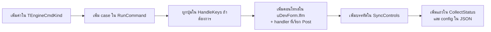

ตัวอย่างที่ทำครบแล้ว: `ckSetMotion` (enum → RunCommand → `[`/`]` → สไลเดอร์ `tbMotion` → SyncControls → แถว "Motion" + `config.motion`)

---

## 10. การทดสอบและเกณฑ์ตรวจรับ

รันทั้งหมดด้วยคำสั่งเดียว (หลัง build `MosaicWall.exe`):

```bash
powershell -ExecutionPolicy Bypass -File tools/verify.ps1
```

ทดลองขนาด cell ก่อนเปลี่ยนค่าเริ่มต้นได้ด้วย `-Cell` (ส่ง `--cell` ให้ทุกการรัน):

```bash
powershell -ExecutionPolicy Bypass -File tools/verify.ps1 -Cell 0.080
```

เกณฑ์ข้อ 1 (R11, ตั้งแต่ v2.2) วัดสีเฉลี่ย 7 แถบ (±3 % ของความสูง) ของ 16 seed แล้วแยกความเพี้ยนที่เป็นระบบออกจากการแกว่งตาม seed:

| ส่วน | ค่าที่วัด | เกณฑ์ | เหตุผล |
|---|---|---|---|
| a. bias | ค่าเฉลี่ยของผลต่าง (มีเครื่องหมาย) ของ 16 seed ทุกแถบทุก channel | ≤ 15 | ความเพี้ยนสีที่ตาเห็นทุกภาพ ค่าคลาดเคลื่อนจากการสุ่มของค่าเฉลี่ยราว ±2.5 |
| b. median | median ของ worst ต่อ seed | ≤ 25 | ภาพทั่วไปยังต้องผ่านเกณฑ์เดิม (±25) |
| c. max | worst สูงสุดของ 16 seed | ≤ 40 | ไม่มีภาพใดเพี้ยนหนัก |

เกณฑ์นี้ตั้งจากเกณฑ์เดิมและค่าของ v2.0/v2.1 ไม่ได้ตั้งจากผลของ R1: v2.0 อยู่ที่ขอบ bias พอดี (15.0 จากช่วงล่างที่มืดเกิน ซึ่ง R2 + R3 แก้แล้ว) v2.1 ผ่านโดยมีระยะเผื่อ (13 / 19.5 / 31)

### 10.1 ผลล่าสุด (2026-10-23, v2.2)

| # | เกณฑ์ | ผล | สถานะ |
|---|---|---|---|
| 1 | สีเฉลี่ย 7 แถบ ของ 16 seed เทียบภาพอ้างอิง: bias ≤ 15, median worst ≤ 25, max worst ≤ 40 | bias 11 · median 21.5 · max 30 | ✅ |
| 2 | seed เดียวกันได้ภาพเดียวกัน | hash ตรงกัน | ✅ |
| 3 | ≥ 60 FPS ที่ 1080×1920 | glow 0: 272 · glow 1: 232 · glow 2: 256 FPS (off-screen) | ✅ |
| 4 | การเคลื่อนไหวเห็นชัด | Motion 0 %: 0 % · 100 %: 12.8 % · 200 %: 25.4 % ของพิกเซลเปลี่ยนใน 0.5 s | ✅ |
| 5 | Frame pacing ใน MosaicWallDev | v2.0: 0 เฟรมเกิน 20 ms, p99 16.9 ms, max 17.7 ms (3 รอบ) · v2.2 ไม่ได้รันซ้ำแบบ 3 รอบ (selftest: p99 16.8 ms) | ✅ |
| 6 | Export ครบ 5 ชนิด, JSON อ่านได้, ปิดโปรแกรมปกติ | `--selftest` exit code 0 (v2.2) | ✅ |
| 7 | ปุ่มและคอนโทรลทำงานจริง | ทดสอบคลิกด้วยเมาส์ (v2.0, หลังจากนั้นเปลี่ยนเฉพาะค่าเริ่มต้นของแถบ cell): reseed, animate, vignette, HUD, render, export | ✅ |
| 8 | ไม่มีหน้าต่าง console | PE subsystem = 2 (GUI) ทั้งสองโปรแกรม (v2.1, build v2.2 ใช้ตั้งค่าเดิม) | ✅ |

### 10.2 สิ่งที่ยังไม่ได้ทดสอบ

- เปิดฟอร์มใน Lazarus Form Designer (ตรวจเพียงว่าไฟล์ `.lfm` โหลดได้ตอนรัน)
- การ resize ด้วยการลากขอบหน้าต่าง และโหมด fullscreen (มีโค้ดรองรับ แต่ไม่ได้ทดสอบอัตโนมัติ)
- เครื่องที่ใช้ GPU Intel/AMD และจอ DPI สูง

---

## 11. ข้อแนะนำและแผนพัฒนาต่อ

ข้อแนะนำเหล่านี้อ้างอิงผลวิเคราะห์ในข้อ 2 แต่ละข้อทดลองทีละข้อ แล้วรัน `verify.ps1` และ `analyze_image.ps1` เทียบผลก่อนรับเข้า **v2.1: R2 และ R3 รับเข้า · v2.2: R11 (เกณฑ์สี 16 seed) แล้ว R1 ที่ cell 0.076** (ผลอยู่ในตารางนี้และข้อ 2.5, 2.8, 10)

| # | ข้อแนะนำ | เหตุผล (ข้อมูล) | วิธีทำ | ความสำคัญ |
|---|---|---|---|---|
| R1 | เพิ่ม cell — **ทำแล้วที่ 0.076 (v2.2)** | ระยะ tile อ้างอิง 5.9 % เดิม 3.8 % ตอนนี้ระยะกริด 4.3 % · 0.085 ไม่ผ่านเกณฑ์ R11 (bias แดงแถบ 0.6 = 17, max 41) 0.080 พอดีขอบ | `CellRatio := 0.076` ใน `DefaultMosaicConfig` (และค่าเริ่มต้นใน `MosaicWall.lpr`, `uDevForm.lfm`) | สูง |
| R2 | คงน้ำเงินไว้ช่วงล่าง — **ทำแล้วบางส่วน (v2.1)** | อ้างอิงมีน้ำเงิน 15–44 % ที่ 80–100 % เดิม 2–21 % ตอนนี้ 1–21 % (653) / 8–16 % (77) | เพิ่ม TEAL_BLUE w10 ใน Z3Left/Z3Right · ลองแล้ว: BASE w20 ทำให้น้ำเงินถึงเป้า (15–42 %) แต่แถบ 0.9 มืดจน verify ไม่ผ่าน (worst 45) ส่วน TEAL_BLUE w14 / w20 ผ่านแบบเฉียด (25 / 26) จึงใช้ w10 | สูง |
| R3 | ลดร่องดำช่วงล่าง — **ทำแล้ว (v2.1)** | Z2: อ้างอิง 2.7 % เดิม 18.1 % ตอนนี้ 5.9 % · Z3: 1.9 % เดิม 6.5 % ตอนนี้ 1.4 % | hole × 0.2 และ base blob × 1.1 ที่ y > 0.62, accent ช่วงล่างขยาย `1 + 0.35 × smoothstep(0.78, 1.0, y)`, bridge เฉพาะ tile สีสด (ไม่เกิดแท่งน้ำเงินมืด) | กลาง |
| R2b | ขอบซ้ายล่างเป็นน้ำเงิน | อ้างอิงที่ x 0–10 % ช่วงล่างมีน้ำเงิน 61 % warm 31 % ตอนนี้น้ำเงิน 20 % warm 77 % | เพิ่มน้ำหนัก TEAL_BLUE ใน Z3Left ตาม x (มากที่ขอบซ้าย ลดลงจนหมดที่ x ≈ 0.25) แล้ววัดแถบ 0.9 ด้วย verify | กลาง |
| R11 | เกณฑ์สีที่ทนต่อ seed — **ทำแล้ว (v2.2)** | เกณฑ์ ±25 ต่อแถบ ±3 % ของ 4 seed แกว่งตามการสุ่มจนวัดผลของ cell ไม่ได้: build v2.0 เองก็เกิน 25 ใน 2 จาก 16 seed | `verify.ps1` ข้อ 1: 16 seed, bias ≤ 15, median worst ≤ 25, max worst ≤ 40 และ `-Cell` สำหรับทดลอง (ข้อ 10) | สูง |
| R12 | ลด bias แดงที่แถบ 0.6 | bias แดงแถบ 0.6 เพิ่มตาม cell (+5 ที่ 0.076, +17 ที่ 0.085) เป็นตัวที่ทำให้ 0.085 ไม่ผ่าน | ตรวจน้ำหนัก RED / HOT_PINK ใน Z1 และขอบโซน 0.62 แล้วลอง cell 0.080–0.10 ใหม่ด้วย `verify.ps1 -Cell` | กลาง |
| R4 | รูปทรงไม่สม่ำเสมอ | ก้อนในภาพอ้างอิงบิดเบี้ยว ไม่เห็นเป็นกริด (ภาพข้อ 1.4) | หมุนสุ่ม ±8° (วาดด้วย texture หรือ polygon), ความมนแยกแต่ละมุม, รวม 3–4 ก้อนเป็น cluster | กลาง |
| R5 | สีลามแบบภาพจริง | ภาพอ้างอิงมี bleed ชัดช่วงล่าง | shader blur 2 pass (GLSL ผ่าน `LoadShader`) แทน RT 1/4 | กลาง |
| R6 | บันทึก/โหลด preset | ตอนนี้ค่าที่ปรับหายเมื่อปิดโปรแกรม | `config.json` (ใช้ fpjson ที่มีอยู่แล้ว) + ปุ่ม Save/Load ในหน้าต่างนักพัฒนา | กลาง |
| R7 | CI อัตโนมัติ | ป้องกันคุณภาพถอยหลัง | สคริปต์: `lazbuild` ทั้งสองโปรเจกต์ → `verify.ps1` → `MosaicWallDev --selftest` | กลาง |
| R8 | Export hi-res ไม่กระตุก | ตอนนี้กระตุก ~200 ms ต่อภาพ | แบ่งงานทำทีละเฟรม หรือเข้ารหัส PNG บน thread อื่น | ต่ำ |
| R9 | รองรับจอ DPI สูง | ยังไม่ได้ทดสอบ | `FLAG_WINDOW_HIGHDPI` + ทดสอบ LCL scaling | ต่ำ |
| R10 | Tile จำนวนมาก (> 5,000) | ตอนนี้ ~2,000 draw call/เฟรม ยังเร็วพอ | instancing / รวมเป็น vertex buffer เดียว | ต่ำ |

### ลำดับที่แนะนำ

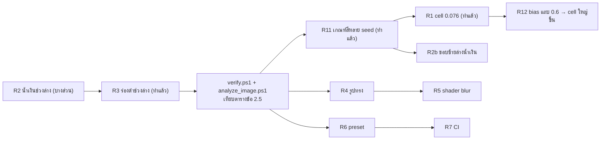

R1–R3 เป็นการปรับค่าตัวเลข ทำแล้ววัดผลได้ทันที (R2 + R3 รับเข้าใน v2.1, R1 ใน v2.2 หลังจากเปลี่ยนเกณฑ์สีเป็นแบบ 16 seed ตาม R11) ส่วน R4–R5 เปลี่ยนวิธีวาด ควรทำหลังจากสัดส่วนสีลงตัวแล้ว

### ข้อจำกัดที่ทราบ

- raylib เปิดได้หน้าต่างเดียวต่อ process จึงต้องใช้ฟอร์ม LCL สำหรับหน้าต่างที่สอง
- ระยะซ้ำแนวนอน (pitch X) ของภาพอ้างอิงที่วัดได้เป็นระยะของกลุ่ม tile ไม่ใช่ tile เดี่ยว ควรใช้ค่าแนวตั้งเป็นหลัก
- ค่าความต่างสีขึ้นกับวิธีวัด: แถบ ±3 % (เกณฑ์ตรวจรับ) ได้ worst ต่อ seed 15–30 แต่แถบ 5 % แยกกัน 20 แถบ (ข้อ 2.8) ได้สูงสุด 36–55 เพราะจังหวะสีในแต่ละแถบแคบต่างกัน

---

## 12. ประวัติการเปลี่ยนแปลง

| วันที่ | เวอร์ชัน | การเปลี่ยนแปลง |
|---|---|---|
| 2026-10-19 | 1.0 | สเปกแรกจากภาพ · พัฒนา M1–M7: generator, renderer, animation, controls, bake, export, CLI |
| 2026-10-19 | 1.1 | ปรับค่าจากการวัดสี (density, น้ำหนัก Z1, หลุมดำรอบ y = 0.5) · แก้ alpha ของ RenderTexture · build เป็น GUI app (ไม่มีหน้าต่าง console ดำ) |
| 2026-10-23 | 1.2 | MosaicWallDev: หน้าต่างสถานะ, กราฟ, controls, export JSON/TXT/CSV/PNG · engine ร่วม · render thread (แก้อาการกระตุกทุก 250 ms) |
| 2026-10-23 | 1.3 | Motion: คลื่นแสง, breathing/drift/twinkle แรงขึ้น ~7 เท่า, ปรับได้ 0–300 % |
| 2026-10-23 | 2.0 | **วิเคราะห์ภาพใหม่ทั้งหมด** ด้วยเครื่องมือวัด (hue, palette k-means, pitch, ขอบ) · เปรียบเทียบกับภาพที่สร้าง · เพิ่มภาพประกอบ, flow chart, คู่มือติดตั้ง/ใช้งาน/นำไปใช้, ข้อแนะนำจากข้อมูล · เพิ่ม `--cell` · `tools/verify.ps1` |
| 2026-10-23 | 2.1 | ทำ R2 + R3 จากข้อ 11: Z3 มี TEAL_BLUE w10, hole × 0.2 และ base blob × 1.1 ที่ y > 0.62, accent ช่วงล่างขยายถึง × 1.35, bridge เฉพาะ tile สีสด · ร่องดำ Z2 18.1 → 5.9 %, Z3 6.5 → 1.4 %, เกณฑ์สี worst 22 → 21 · R1 (cell 0.085) ทดลองแล้วไม่ผ่านเกณฑ์สี คง 0.068 · เพิ่ม R2b, R11 · อัปเดตตาราง 2.5, 2.6, 2.8, 2.9, 3.1, 3.3, 10.1 และภาพเปรียบเทียบ |
| 2026-10-23 | 2.2 | R11: `verify.ps1` ข้อ 1 ใช้ 16 seed (bias ≤ 15, median worst ≤ 25, max worst ≤ 40) และเพิ่ม `-Cell` · R1: `CellRatio` 0.068 → 0.076 (ระยะกริด 3.8 → 4.3 %, bias 13 → 11) 0.080 พอดีขอบ 0.085 ไม่ผ่าน · เพิ่ม R12 · อัปเดตตาราง 2.5, 2.6, 2.8, 2.9, 8.2, 10, 11, ภาคผนวก A และภาพเปรียบเทียบ |

---

## 13. ภาคผนวก

### A. ค่า config ทั้งหมด (`TMosaicConfig`)

| ฟิลด์ | ค่าเริ่มต้น | ช่วง | ความหมาย |
|---|---|---|---|
| `Seed` | 653 | 0–999,999,999 | seed ของการสุ่ม |
| `CellRatio` | 0.076 | 0.04–0.12 | ขนาด cell / ความกว้างจอ |
| `JitterPos` | 0.22 | – | การเลื่อนตำแหน่ง accent (× cell) |
| `HoleChance` | 0.15 | – | โอกาสพื้นฐานของร่องดำ |
| `BridgeChance` | 0.30 | – | โอกาสเชื่อมก้อน (y > 0.6) |
| `Animate` | True | – | เปิดการเคลื่อนไหว |
| `Motion` | 1.0 | 0–3 | ความแรงการเคลื่อนไหว |
| `GradientScroll` | False | – | สีไหล |
| `GlowMode` | 1 | 0–2 | แสงฟุ้ง |
| `Vignette` | 0.12 | 0–1 | ขอบมืด |
| `ZoneNoise` | 0.08 | – | ความไม่ตรงของขอบโซน |
| `Dim` | False | – | ทำภาพมืดลง α40 |

### B. ไฟล์ข้อมูลและเครื่องมือ

| ไฟล์ | สร้างด้วย | เนื้อหา |
|---|---|---|
| `docs/data/reference_analysis.json` | `analyze_image.ps1` | ผลวัดภาพอ้างอิง |
| `docs/data/render_analysis.json` | `analyze_image.ps1` | ผลวัดภาพ seed 653 |
| `docs/img/fig_*.svg` | `make_figures.py` | กราฟและแผนภาพ |
| `docs/img/compare_reference_render.png` | PowerShell + `MosaicWall --shot` | ภาพเปรียบเทียบ |
| `docs/img/render_seed653.png` | `MosaicWall --shot` | ภาพตัวอย่าง 1080×1920 |
| `docs/img/motion_strip.png` | `MosaicWall --shot --time` | 4 เฟรมของการเคลื่อนไหว |
| `docs/img/dev_form.png` | จับภาพหน้าต่างจริง | หน้าต่างนักพัฒนา |

### C. คำศัพท์

| คำ | ความหมาย |
|---|---|
| Cell | ช่องกริดที่ใช้วาง tile ขนาด = ความกว้างจอ × CellRatio |
| Accent | tile ชั้นบนที่มีสี (vivid = สีสด, muted = กลืนกับพื้น) |
| Base blob | ก้อนสีพื้นชั้นล่างที่ทับกันจนเหลือร่องดำ |
| Bridge | ส่วนเชื่อม 2 ก้อนให้เป็นรูป L หรือแท่ง |
| Bake | วาดฉากลง RenderTexture ครั้งเดียว แล้วนำภาพมาใช้ซ้ำ (ตอนหยุด) |
| p95 / p99 | เวลาที่ 95 % / 99 % ของเฟรมทำได้เร็วกว่าหรือเท่ากับค่านี้ |
| Pitch | ระยะที่ลวดลายซ้ำ วัดจาก autocorrelation |
| Frame pacing | ความสม่ำเสมอของเวลาแต่ละเฟรม (ไม่กระตุก) |
